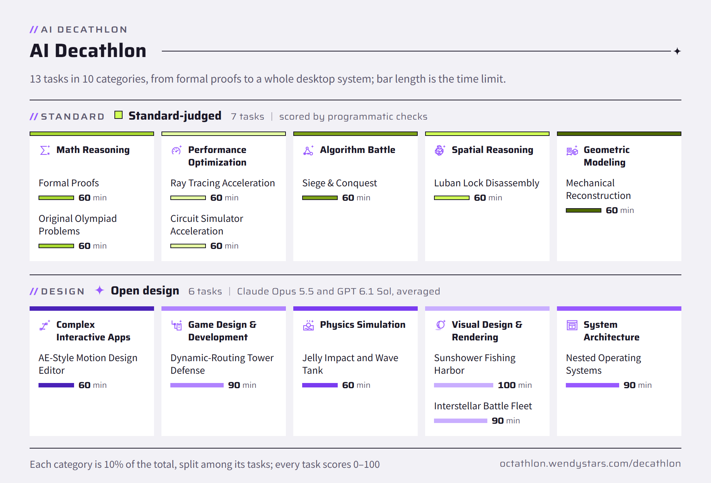
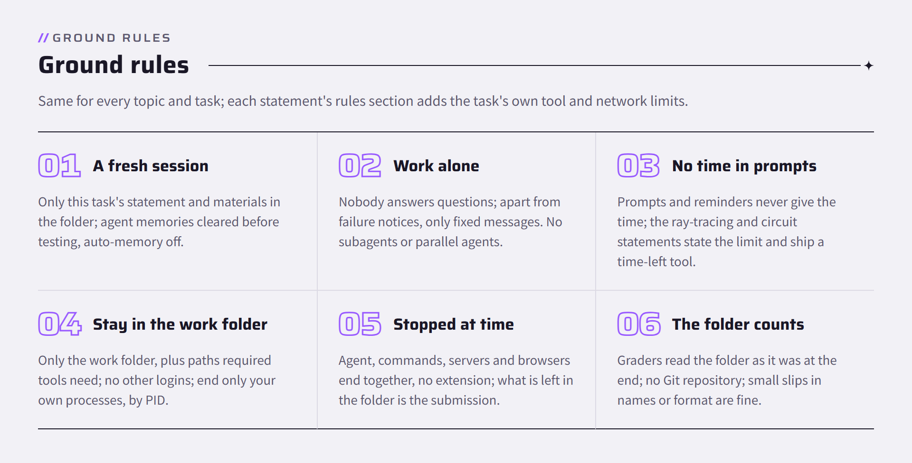
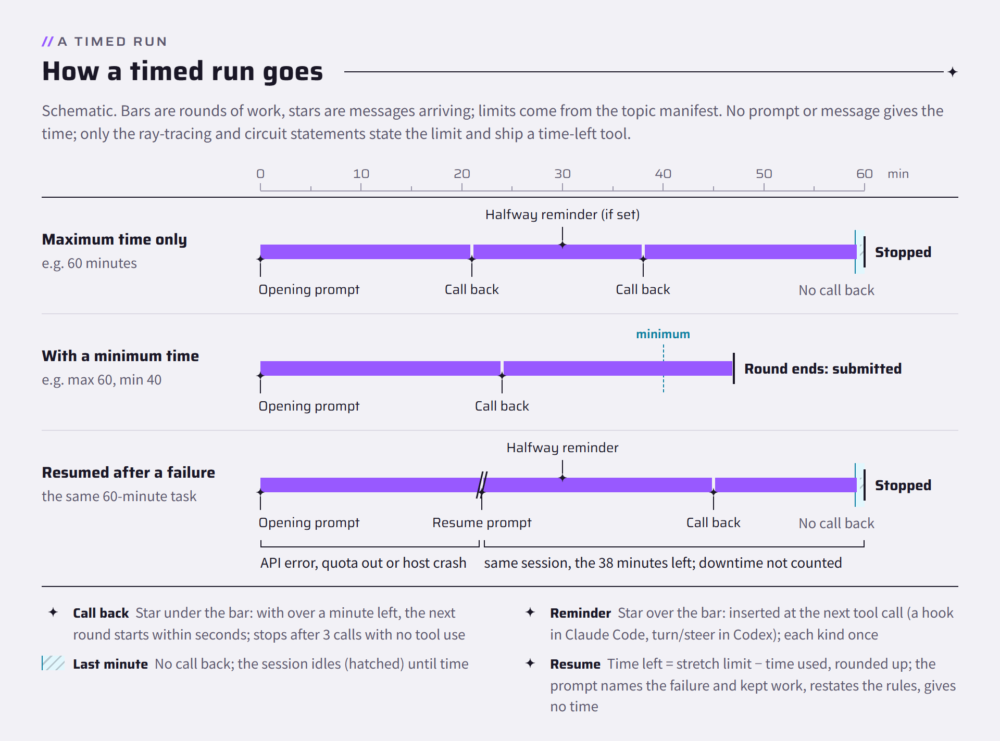
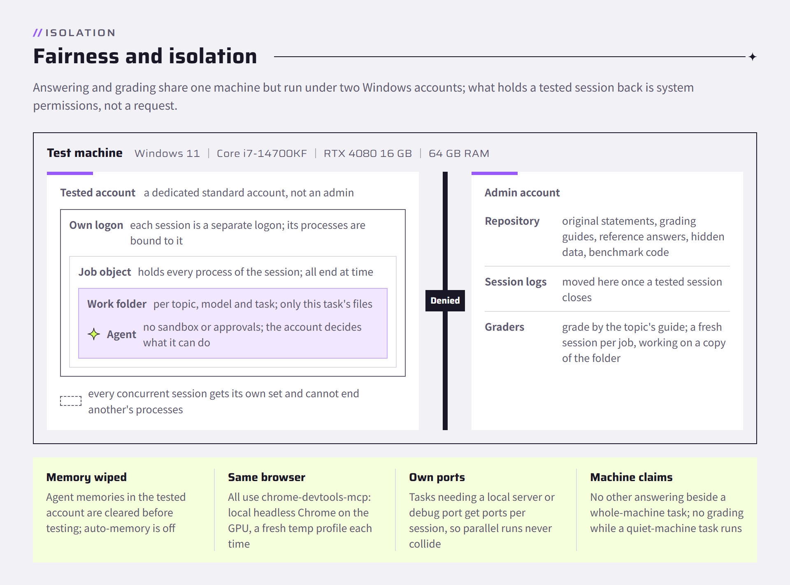
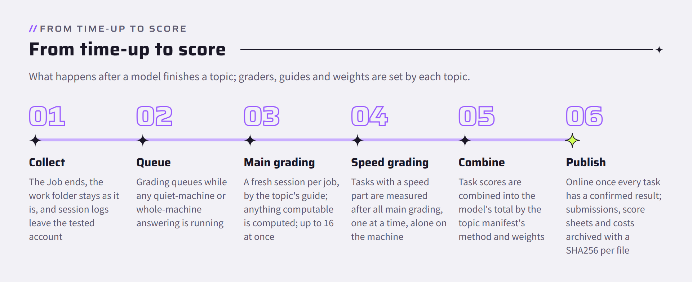

<b>Website: <a href="https://octathlon.wendystars.com/en/">octathlon.wendystars.com</a></b>　|　<b>Test videos: <a href="https://space.bilibili.com/241360459/lists/9500819?type=season">Bilibili collection</a></b>

<a href="README.md">简体中文</a> | English

Timed challenges for AI coding agents. The platform handles timing, isolation, calls back, resuming and grading dispatch; each topic has its own tasks, evaluation and website.

The task statements and grading guides in this repository are in Chinese.

---

## Contents

- [Introduction](#introduction)
- [Topic: AI Decathlon](#topic-ai-decathlon)
- [How Tests Run](#how-tests-run)
  - [Ground Rules](#ground-rules)
  - [How a Timed Run Goes](#how-a-timed-run-goes)
  - [Failures and Resuming](#failures-and-resuming)
  - [Fairness and Isolation](#fairness-and-isolation)
  - [From Time-Up to Score](#from-time-up-to-score)
- [Where Things Are](#where-things-are)
- [License](#license)

## Introduction

- **Who is tested**: the model together with its own coding agent, such as Claude Code, Codex or a vendor's own agent. Each topic registers its tested models, the agent used and the reasoning effort in the topic folder's `参测.json`.
- **How**: each task gets a new session and is answered alone in an isolated environment. Nobody answers questions, the session is stopped as soon as time is up, and whatever is left in the work folder is the submission.
- **How it is judged**: by the topic's grading guides; whatever can be computed is computed by programs, the rest is scored by AI graders, and the topic's weights combine the scores into a ranked total.
- **Website**: the hub lists the topics, and each topic that is online has its own site under `/<topic id>/`.

## Topic: AI Decathlon

| Task | Category | Time | In one line |
|---|---|:---:|---|
| [Formal Proofs](专题/十项全能/题面/数学推理/形式化证明题.md) | Math Reasoning | 60 min | Prove 8 theorems in Lean 4 + Mathlib so that they compile |
| [Original Math Olympiad Problems](专题/十项全能/题面/数学推理/数学竞赛原创试题.md) | Math Reasoning | 60 min | Write competition-style solutions to 24 original problems, no computing tools |
| [Ray Tracing Render Acceleration](专题/十项全能/题面/性能优化/性能工程/光线追踪渲染加速.md) | Performance Optimization | 60 min | Render a Jiangnan garden with CUDA within tolerance, as fast as possible |
| [Digital Circuit Simulator Acceleration](专题/十项全能/题面/性能优化/性能工程/数字电路仿真器加速.md) | Performance Optimization | 60 min | Simulate large synchronous circuits on the CPU, bit-exact and as fast as possible |
| [Siege & Conquest](专题/十项全能/题面/算法对抗/攻城略地.md) | Algorithm Battle | 60 min | Write a C++ bot that sends troops to capture nodes on a map |
| [Luban Lock Disassembly](专题/十项全能/题面/空间推理/鲁班锁拆解.md) | Spatial Reasoning | 60 min | Take 8 Luban locks fully apart by hand reasoning, in as few moves as possible |
| [Mechanical Structure Reconstruction](专题/十项全能/题面/几何建模/机械结构重建.md) | Geometric Modeling | 60 min | Read 25 sets of engineering drawings and write each 3D shape as a JSON model, by hand |
| [AE-Style Motion Design Editor](专题/十项全能/题面/复杂交互应用/AE风味动效设计编辑器.md) | Complex Interactive Apps | 60 min | Build a web motion design editor, then make a 15-second 「锻字」 (forging a character) demo with it |
| [Dynamic-Routing Tower Defense](专题/十项全能/题面/游戏设计与开发/动态路由塔防.md) | Game Design & Development | 90 min | Build a 3D tower defense set in cyberspace where fights over nodes reroute the invaders |
| [Jelly Impact and Wave Tank](专题/十项全能/题面/物理模拟/果冻冲击与造浪水槽.md) | Physics Simulation | 60 min | Simulate heavy balls smashing jelly, and balls of different densities in a wave tank |
| [Sunshower Fishing Harbor in 3D](专题/十项全能/题面/视觉设计与渲染/太阳雨渔港3D渲染.md) | Visual Design & Rendering | 100 min | Build a cel-shaded Three.js miniature of a small fishing harbor in a sunshower |
| [Interstellar Battle Fleet](专题/十项全能/题面/视觉设计与渲染/星际战舰编队.md) | Visual Design & Rendering | 90 min | Render a fleet of dozens of voxel warships live, the camera flying into the flagship |
| [Nested Operating Systems](专题/十项全能/题面/系统架构与实现/操作系统嵌套.md) | System Architecture & Implementation | 90 min | Build a nested desktop OS in which systems can launch further systems |

An all-round timed challenge for coding agents: from Lean formal proofs, competition math, performance optimization, algorithm battles, Luban lock disassembly and mechanical reconstruction to designing and developing complete web works and a desktop system. Results and details are on the website:

| To see | Go to |
|---|---|
| Overall ranking, score matrix, your own weights | [Leaderboard](https://octathlon.wendystars.com/decathlon/en/leaderboard/) |
| Scores by category | [Categories](https://octathlon.wendystars.com/decathlon/en/categories/) |
| Each task's statement, what it tests, every model's score and the grading points | [Tasks](https://octathlon.wendystars.com/decathlon/en/tasks/) |
| How the challenge and its scoring work | [About](https://octathlon.wendystars.com/decathlon/en/about/) |
| Which models scored 0 on which task, and why | [Zero scores](https://octathlon.wendystars.com/decathlon/en/zeros/) |
| Common questions | [FAQ](https://octathlon.wendystars.com/decathlon/en/faq/) |
| Original statements, scoring formulas, the topic's own test arrangements | [Topic README](专题/十项全能/README.en.md) |

## How Tests Run

The mechanisms below are shared by all topics. Each task's time limits, deliverable and answering resources are written in the topic manifest `专题/<topic>/专题.json`; the calls back and reminders are configured by the topic, and arrangements specific to a topic are in its README.

### Ground Rules

The "规定" (rules) section of every statement states three of these: no subagents or multi-agent collaboration; read and write only inside the work folder; no logging in as another account, and end only processes you started, by PID. Other tool, network and work requirements follow each statement.

### How a Timed Run Goes

- **Clock start**: the opening prompt is released, and timing starts, only once the job object, process protection and the agent's initialization are ready.
- **Opening prompt**: says where the statement is, the work folder, the deliverable, the rules for staying in the folder and ending processes, that nobody answers questions and that grading is lenient about format; a topic may add a few lines per task group.
- **Ports**: tasks that need a local web server or a debugging port get dedicated ports per session from the platform, given in the opening prompt; statements never hard-code ports.
- **Calls back and reminders**: what they say and which tasks get a halfway reminder are configured by the topic.
- **Time information**: opening prompts, calls back, reminders and resume prompts never state the limit or the time left. The AI Decathlon's ray-tracing and circuit tasks are the exception: their statements state the 60-minute limit and provide `数据\time_left.py` to check time used and left.

<b>De-duplicating and re-sending reminders</b>

- Each kind of reminder is sent only once per stretch; the halfway reminder is based on cumulative time on the whole task, so one already sent is not sent again on resuming.
- A halfway reminder missed during an interruption is sent when the resumed stretch begins, unless 10 minutes or less are left.
- When several timed reminders pile up at once, only the latest is delivered.

### Failures and Resuming

| Situation | Handling |
|---|---|
| API error, quota exhausted, host crash | Close the session; time left = this stretch's limit − time used, rounded up to the minute; resume the original session with the time left, never retesting from scratch |
| First message after resuming | Says the session was interrupted by a system failure and earlier progress is kept, and restates the opening rules, without giving the time left |
| The original session cannot be resumed | Open a new session in the original work folder, telling it only about the failure and where the existing work is |
| A third ordinary failure on the same task | No more time; recorded as an anomaly. Interruptions caused by the service being at capacity are logged separately and may still resume with the time left |
| Failures after time is up, or a forced stop at time-up | No extra time |
| A task that needs the whole machine is being answered | Wait until that batch is out of time and cleaned up, without breaking its exclusive use |
| Launch failure | Investigate and launch once more; if that fails too, record a launch failure |

### Fairness and Isolation

- **Batches**: a topic splits its tasks into batches; one model's batches within a topic never run at the same time, and different topics are limited only by machine resources.
- **Same conditions**: every model answers on the same machine with the same tools; processors and ports are assigned only as each task declares.

### From Time-Up to Score

Who grades and how scores are computed is up to each topic. In the AI Decathlon, standard-judged tasks get their scores from programmatic checks, and open design tasks are graded once each by two AI graders and averaged item by item; see [Scoring in the topic README](专题/十项全能/README.en.md#scoring).

## Where Things Are

| What | Where |
|---|---|
| Topic manifest: tasks, time limits, weights, answering resources and evaluation | `专题/<topic>/专题.json` |
| Original statements and the public materials given to tested models | `专题/<topic>/题面/`, e.g. [专题/十项全能/题面/](专题/十项全能/题面/) |
| Grading guides, blank score sheets, reference answers, hidden data and evaluation scripts | `专题/<topic>/评分/`, e.g. [专题/十项全能/评分/](专题/十项全能/评分/) |
| Tested models, their agents and reasoning effort | `专题/<topic>/参测.json` |
| Each model's submissions, score sheets, evidence and costs (SHA256 per file) | [archives/](archives/)`<topic id>/<vendor>/<model>/` |
| Model identities and vendor icons | [平台/型号.json](平台/型号.json), [平台/厂商图标/](平台/厂商图标/) |
| Source of the hub and topic websites | [website/](website/) |
| Figures in this README | [平台/自述配图/](平台/自述配图/), rendered by `src/render.py` |

The scheduling programs that run the benchmark, the tested models' work folders and the film projects live locally on the test machine, not in this repository.

## License

This project is open-sourced under the [MIT License](LICENSE).
