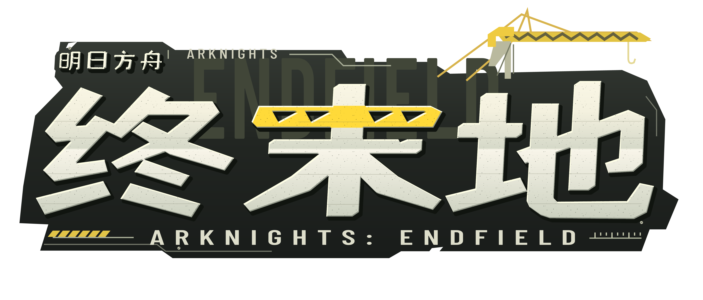
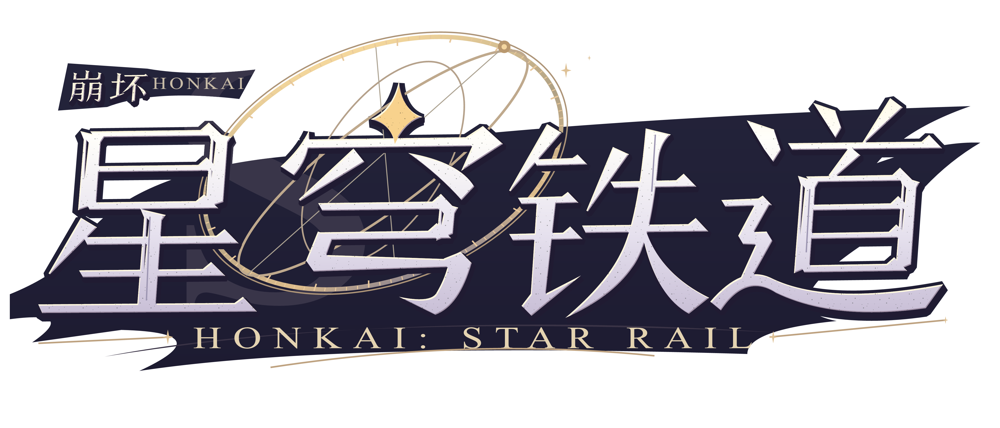
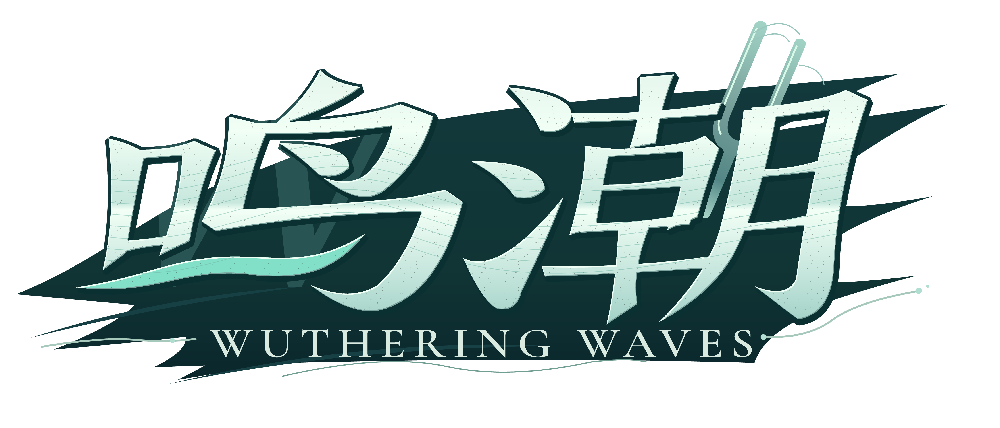

# 形研所 · 游戏字形档案

**第一卷收录《明日方舟：终末地》《崩坏：星穹铁道》和《鸣潮》的三枚原创中文字标。** 冲压钢梁、黄铜星盘和被音叉扰动的水面，分别提供一套笔画语言。

用 Chrome 直接打开根目录的 [index.html](index.html)。首页的三张海报均可进入独立展页。每件作品依次展示概念、笔画对照、母题落点、黑白稿、六层分色和可读性检查。笔画对照可逐字切换，开启「构件标注」即可看到手绘笔形的分件。分层图支持展开、叠合和单层检视，检查格可单独检视中文。

## 图版 01　明日方舟：终末地



**桁梁铸字。** 把塔卫二的拓荒工地缩进字面，让「末」的一横成为承重桁梁。

| 概念单 | 设计 |
|---|---|
| 气质 | 坚实、精密、开拓 |
| 物件与动作 | 穿孔钢梁。吊起、对位、铆合。 |
| 同源媒介 | 从集成工业的生产与建设，联想到车间里的冲压钢板、吊装构件和设备铭牌。世界观参考[终末地开发通讯](https://endfield.gryphline.com/en-us/news/1340)。 |
| 底字与方言 | 参考重黑体的承重比例，在百格字身内重画横、竖、折、斜梁。竖向构件厚于横梁，端角统一削平。横画留一个斜向浅冲口。「明日方舟」四字也使用这套钢板构件。 |
| 骨架 | 字身低而宽。「终」的绞丝旁收紧，「末」居中展开，「地」以横向竖弯钩承住右缘。完成正立结构后，全组向右斜切约三度。 |
| 母题高潮 | 「末」的首横是一根有四个三角腹孔的连续梁。中央实心区供中竖穿过，上、下翼缘维持横笔的方向与长度。 |
| 同族呼应 | 「地」的土字横及「方」「日」的横端采用浅三角冲口。只在高潮处贯穿腹板。 |
| 主体元素 | 桥式吊机从「地」右肩挑出，吊臂把首横的三角腹孔转成真实的桁架，垂下的吊钩停在字外。 |
| 英文组合 | 大写 ENDFIELD 低明度压在主名后。ARKNIGHTS 嵌入系列名右侧；完整的 ARKNIGHTS: ENDFIELD 排在底部检修尺线上。窄体无衬线的平直切口呼应钢梁。 |
| 颜色角色 | 字面为钢面白 `#F4F1DF`，底板为铁灰 `#353A34`，贴边阴影为氧化黑 `#191C1A`，左上磨边为浅银 `#FFFFE6`。工程黄 `#FFDA39` 集中在「末」的长横，并由吊臂与警示斜条呼应。 |
| 材质与场景 | 字面的浅灰反射带掠过折角，细划痕裁切在钢板轮廓内。背景以高度场生成山谷，以斜投影绘制吊塔、厂房和架空输送线。 |

**原创细节**　「末」的上下两横分别承担穿孔梁和实心横撑。遮去吊机后，汉字本身仍呈现一套可受力的构造。

## 图版 02　崩坏：星穹铁道



**穹顶定星。** 将列车的旅途刻在黄铜星盘上，以「穹」顶的一点校准航向。

| 概念单 | 设计 |
|---|---|
| 气质 | 典雅、辽远、流动 |
| 物件与动作 | 星盘上的定向指针。转动子午圈，找准航星，向前行。 |
| 同源媒介 | 列车与无名客的开拓旅程，引出旅途中的天文仪器与铜版刻字。星盘是本案的设计意象。世界观参考[《星穹铁道》官方开拓任务与列车活动资料](https://hsr.hoyoverse.com/en-us/news/123034)。 |
| 底字与方言 | 参考明朝体的横细竖粗，逐笔构造「崩坏」「星穹铁道」。细横微升，末端挑成三角刀锋；粗竖内刻渐消的细槽。撇捺以尖锋离开纸面。 |
| 骨架 | 四字沿微弧起伏，「穹」略大且上提，「铁」取较窄字身。系列名嵌入「星」的左上肩。横向的英文基线为起伏的中文提供稳定参照。 |
| 母题高潮 | 「穹」的穴首点改作四向定星指针。上下尖端较长，下尖对准穴部中轴，在原点的体量里同时表达屋顶和天空。 |
| 同族呼应 | 「道」的点收成指针的一面，「铁」的斜锋、系列名的起笔重复同方向的削面。 |
| 主体元素 | 黄铜浑天星盘斜抱「穹」。外圈百道刻线、中间的赤道圈、斜轴铜销组成同一件仪器。所有圈线落在字面下方。 |
| 英文组合 | 大写 S 埋在深靛底板内。HONKAI 与系列名相邻，全称 HONKAI: STAR RAIL 使用有粗细对比的罗马大写，沿字脚拉开。 |
| 颜色角色 | 字面为星瓷白 `#FFFEFA`，底板为暮靛 `#24243B`，贴边阴影为墨紫 `#201B32`，左上刃口为象牙光 `#FFF8DE`。黄铜金 `#F8D28D` 只在主指针上达到最高亮度，星盘沿用较旧的铜色。 |
| 材质与场景 | 明亮刻面和细暗槽模拟珐琅表盘上的金属刻字。背景通过球面法线计算行星昼夜与纬向云带；行星环分远、近两段遮挡，列车沿图版下缘的曲线轨道驶出。 |

**原创细节**　把「穹」顶的一个点作为定星基准，而将仪器的旋转自由度留给字后的斜环。指针与环轴处于不同角度，静止字形因此有了校准中的姿态。

## 图版 03　鸣潮



**潮声留痕。** 取音叉激起水面的瞬间，让「鸣」的末横留下一次尚未消散的振动。

| 概念单 | 设计 |
|---|---|
| 气质 | 清冽、游动、回响 |
| 物件与动作 | 音叉激起的驻波。激振、回卷、衰减。 |
| 同源媒介 | 从索拉里斯的频率与共鸣，推演出湿墨拖过覆水玉版的痕迹。世界观参考[《鸣潮》官方频率与共鸣者叙事资料](https://wutheringwaves.kurogames.com/en/main/news/detail/4447)。 |
| 底字与方言 | 以行楷的蓄力、提锋为参考，直接绘制两字每笔的双侧贝塞尔边界。横画两岸一缓一急；点如蓄水的笔腹；竖画先粗后提，钩尾回卷。 |
| 骨架 | 「鸣」左口舒展，鸟部下钩围出容纳波峰的负形。「潮」的朝部略收紧，月部放开。后字微升，细横向右上提。 |
| 母题高潮 | 鸟部的最后一横保留起止位置与横向动势，中段先隆起再回落，尾端扬起成为驻波波峰。 |
| 同族呼应 | 「潮」的日、月内横和十字横逐渐减小起伏，只留下略向右提的水线。三点水的蓄墨端呼应波峰的厚度。 |
| 主体元素 | 双股音叉从月部上方斜出，叉柄顺着月钩沉入深青底板。读字时，叉齿之间的空隙保留了器物轮廓。 |
| 英文组合 | 巨大的 W 裁进青墨底板，成为第二层水影。WUTHERING WAVES 以拉开字距的罗马衬线字收底，两侧余波接住英文基线。 |
| 颜色角色 | 字面为玉白 `#F1FFF5`，底板为渊青 `#12393D`，贴边阴影为深水墨 `#0A272C`，受光水缘为 `#EFFFF5`。波心绿 `#83E0C8` 强调鸟部末横，并在音叉材料上留下较冷的反光。 |
| 材质与场景 | 透玉般的反射带与细水线沿笔画裁切。背景以连续曲线绘制翻卷的浪壁，把方向不同的刻线分别裁入迎水面与背水面，再沿浪脊铺泡沫与飞沫。 |

**原创细节**　以「鸣」的末横记录最强振幅，以「潮」的数道内横记录余振。字序同时承担声波从激发到衰减的时间顺序。

## 图像与制作源

三枚 Logo 均使用 **4480 × 1920、RGBA 透明画布**。每个目录中的 `final.png` 为成品，`mono.png` 为按图层重新分配灰阶的黑白稿。六张透明 PNG 位于 `layers/`，按文件名前两位从小到大叠加即可还原成品。主题底板是 Logo 的组成部分，画布外沿保留透明。

检查格使用由原尺寸图像降采样得到的 **149 × 64 PNG**。完整标识与纯中文字分别出样，展示片复用同一份完整标识缩样，在 4K 画面中仍能观察小尺寸栅格化后的笔画。

| 位置 | 内容 |
|---|---|
| [终末地图版](logos/终末地/) · [星穹铁道图版](logos/星穹铁道/) · [鸣潮图版](logos/鸣潮/) | 成品、黑白稿与同坐标分层 PNG |
| [lettering.py](source/lettering.py) | 手绘的笔画、部件、母题及字身坐标 |
| [editions.py](source/editions.py) | 轮廓布尔运算、暗边与高光、器物和英文字面、分层输出 |
| [scenery.py](source/scenery.py) | 三种确定性场景绘制程序，分别构图为海报与横幅 |
| [specimen.py](source/specimen.py) | 首页「末」字套版轴测图 |
| [catalog.js](assets/catalog.js) · [editions.js](assets/editions.js) | 展签文本和三件作品的矢量图层 |
| [gallery.js](assets/gallery.js) · [film.js](assets/film.js) | 展页、笔画检视、分层交互与逐帧影片 |

矢量处理复用了题面提供的 `glyphbase.geom` 与字体轮廓管道。对照用底字来自本机思源黑体、思源宋体与楷体。所有中文成品笔画均在独立的字身坐标中绘制。英文字形在制作时转为轮廓。网页使用本地字体子集，来源见 [字体声明](assets/fonts/NOTICE.txt)。

网页直接使用已生成的文件。重新制图所用的 Python 库包括 fontTools、skia-pathops、NumPy、Pillow、OpenCV 和 resvg-py；界面字体子集使用 Brotli 压缩。

## 90 秒展示片

三件作品各占 30 秒，顺序为终末地、星穹铁道、鸣潮。每段先按底板、背景英文、主体元素、文字、细线、高光装配，再进入方言、母题、分层、黑白与缩尺检查，最后停在成品上。

网页右上角的「播放展示片」可预览、暂停和拖动时间轴，按 Esc 返回。导出使用同一套镜头，隐藏操作界面，按调用方传入的帧号取样。

```js
window.videoExport.runs                              // ['show']
const { frames } = await window.videoExport.begin('show', { fps: 60 })
for (let i = 0; i < frames; i++) {
  await window.videoExport.frame(i)
  // 此处由外部调用方截取窗口
}
window.videoExport.end()
```

3 fps 为 270 帧，60 fps 为 5400 帧。第 `i` 帧的时间为 `i / fps` 秒。镜头采用 16∶9 构图，随窗口等比缩放，可在 3840 × 2160 下直接取帧。
