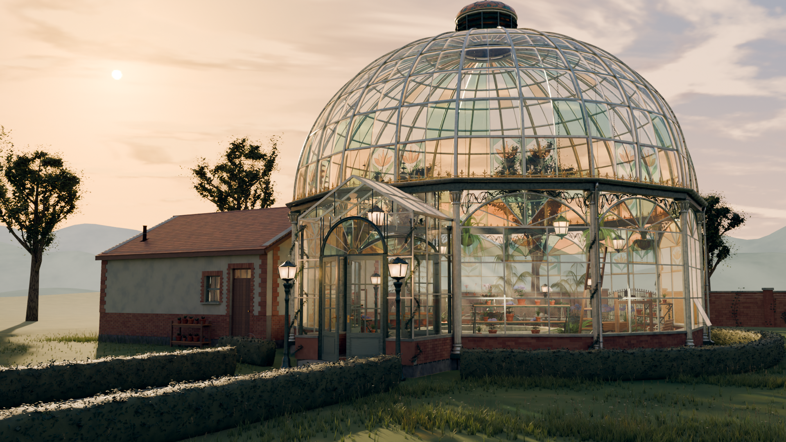

# 阿芙琳温室 · 六月薄暮

*Les Serres Aveline — Vêpres de juin*

西北方的夕阳从蕨叶之间斜入池面，室内的第一排灯已经亮起。睡莲纹样在穹顶彩玻与茶具的釉下蓝彩上呼应。池沿有水草饰带，钟罩和花房旧招牌上仍能读到园圃的名字。



## 文件与机位

主场景为 [greenhouse_final.blend](greenhouse_final.blend)。打开时位于第 1 帧，按原有十个切镜标记播放，范围为 1–1440 帧，24 fps。六张静帧取自同一个第 512 帧，分别使用原有 STILL 相机。主场景的动画输出前缀为 `//tour/frame_`，六张交付静帧位于 `stills/`。

| 静帧 | 机位 | 画面 |
|---|---|---|
| [01](stills/01.png) | STILL_01 | 透过两扇敞开的门，石板路、喷壶与水池形成近中景，后方是扇窗和花架。 |
| [02](stills/02.png) | STILL_02 | 逆光的垂蕨、吊灯和彩玻腰带。 |
| [03](stills/03.png) | STILL_03 | 铜狮吐水，落点的环波切开睡莲与穹顶的倒影。 |
| [04](stills/04.png) | STILL_04 | 育苗钟罩上的字、细小凝露与子叶。 |
| [05](stills/05.png) | STILL_05 | 桌面的植物图鉴、剪刀与花束，拱门外可见铜泉。 |
| [06](stills/06.png) | STILL_06 | 从东南侧草地看整座温室，余晖穿过穹顶。 |

## 光与色

太阳位于西偏北 38°，高度约 16.7°。为场景生成的全景天空包含低处的金杏色、较高处的灰紫蓝和受光云缘，另给散射光保留偏冷的天光。主厅有一个沿檐口收进穹顶的封闭雾体。均匀消光系数约为每米 0.0028，基础天光在雾中的散射用常量源项近似。十七束局部暖光分别按视线穿过椭球密度场的弦长积分，随相机横移发生视差。靠水的方位有很淡的琥珀和青绿色透光。

20 个原有发光件各自带有发光材质和对应的局部光源。十二盏带玻璃罩的灯按照实际光心与罩片的距离、入射角计算乳白透光，嵌入铁框的边缘稍暗。炉火比灯笼更红。工作室留出窗侧的冷填光，黄铜吊灯把光压在工作台上。育苗台的补光限制在苗床上。火盆的辅助点光源只负责照亮四周，钟罩上的火光反射来自实际发光件，子叶前留有一块清透的玻璃。

全片采用 AgX、Medium High Contrast，曝光 +0.18 EV，白平衡 6430 K。合成节点统一调整阴影和中间调，对高光加轻微雾状辉光，最后叠入径向暗角和细颗粒。钟罩、喷泉、工作台与茶桌分别设置了对焦位置和光圈。

## 表面与手工图样

- **玻璃与铜。** 建筑薄玻璃按入射角分配透射和天空反射，边缘叠入水痕、薄尘和轻微的轧制不平。门扇保留室内反射。琥珀、浅青和彩绘玻璃沿檐口、扇窗和采光亭有节奏地重复。钟罩和器皿使用实体折射。喷泉的曲率与不同尺度的噪声共同分出铜绿、氧化带和抛光铜色，三者有不同的粗糙度与金属度。
- **建筑与家具。** 象牙白主骨架配深绿搪漆横梁，剥漆处露出旧铁。逐块石材、砖和陶盆有独立色差。池边压暗湿痕，石板有细粒凹凸，陶盆上沿有析盐。橡木沿长边生成木纹，亚麻和麻布用经纬交叉纹。茶壶、糖罐和茶杯共享一幅手绘睡莲转印图，横跨壶腹的凸棱连续排布，外面覆有透明釉。杯碟用青灰色弧线与旧金边收口。两杯琥珀色茶水依照杯子实测内壁收边，贴壁液面上翘约 0.45 毫米。开启式窗的窗框为象牙白漆铁，铰链和撑杆分别为黄铜与旧青铜，玻璃内沿留有细油灰线。
- **花与土。** 蕨、常春藤、玉簪、兰叶和浮叶分别控制色阶、蜡质反射和透光。叶脉沿生长 UV 排布，薄叶用表面反光和背面透光表现。绣球按花头和单片萼片分配蓝紫色差，睡莲外轮为玫瑰粉，靠近花蕊的一轮转为暖象牙色。梁下干花的褪色花头保留淡赭和灰紫，上方花茎偏麦秆色。钟罩内的深色苗土上散有树皮、炭屑和浅色砂粒。池边叶片与玻璃上的水珠有独立高光。钟罩肩部的凝露沿玻璃切面附着，较大的水珠顺重力方向略微拉长。草地边缘用细草、种穗和少量白花承接低角度夕照。
- **印刷物。** 睡莲彩玻底稿、池沿镶饰、茶具釉下转印、三种种子袋、报纸、图鉴页、育苗批次字样和工作室墙面招牌均为本场景绘制。天空与图样已经打包进场景。

## 动态

四处狮口落水点各有向外衰减的行进环波。水流法线随时间平移，细飞珠以错相的弧线循环起落，附近石材用缓移的折光纹近似水面焦散。尘粒由形态键缓缓升沉，少数花瓣按各自的关键帧翻转落下。上方云影场平移，火光的亮度与局部照度一起轻微起伏。炉膛和火盆的炭红、橘黄、亮金色热斑沿焰体缓慢流动。蒸汽从瓷壶嘴的开口升起，先聚成窄缕，再随微弱气流偏向一侧，分丝消散。上述动态均保存在 Blender 数据中，渲染时直接生效。已在第 1、604、1428 帧核对水波、流动法线、云影位移、蒸汽、花瓣、尘粒与烛光的求值变化。

## 渲染与实测

Blender 5.1.2，Cycles GPU Compute，RTX 4080，OptiX 后端。输出为 1920 × 1080、100%、RGB PNG，自适应采样上限 28、下限 6、噪声阈值 0.085，Cycles 输出原始图像及降噪反照率、法线通道，合成器的首节点调用 GPU Open Image Denoise，采用高质量与精确预过滤。之后才进行调色与辉光。路径追踪设有 3.6 秒采样预算，实际采样数随画面收敛情况和设备负载而变。开启持久数据，合成器使用 GPU。石面折光纹和乳玻璃罩的可见亮度由材质保留，直接照度由太阳和对应的局部光源采样。场景存储 GPU Compute 选项，OptiX 后端由本机 Cycles 设备偏好或 Blender 命令行的 `-- --cycles-device OPTIX` 选择。

下表来自 Blender 后台原生渲染日志。一次打开主文件，先渲染第 1 帧，再从每段运镜取三个不同位置。每项取 PNG 保存后报告的总用时，包含场景求值、渲染、降噪、合成和写盘。**30 个正式样本平均 4.93 秒/帧**。首帧建立缓存用了 8.49 秒，连同首帧共 31 次输出的平均为 5.04 秒/帧。

| 运镜 | 抽测帧 | 逐帧秒数 | 平均秒数 |
|---|---|---|---:|
| 01　南侧车道 | 41、89、141 | 2.47 / 2.25 / 2.56 | 2.43 |
| 02　穿过门厅 | 193、250、289 | 3.78 / 4.84 / 5.42 | 4.68 |
| 03　绕池横移 | 331、389、437 | 6.35 / 5.53 / 5.34 | 5.74 |
| 04　从喷泉仰摇 | 484、561、603 | 5.28 / 5.36 / 4.56 | 5.07 |
| 05　东侧花架 | 644、696、745 | 5.30 / 5.15 / 5.64 | 5.36 |
| 06　茶桌 | 784、827、870 | 5.96 / 5.96 / 6.97 | 6.30 |
| 07　玻璃钟罩 | 906、950、991 | 5.97 / 5.40 / 5.25 | 5.54 |
| 08　进入工作室 | 1034、1093、1155 | 5.76 / 5.84 / 4.80 | 5.47 |
| 09　工作台横移 | 1194、1246、1305 | 4.47 / 4.94 / 3.56 | 4.32 |
| 10　东南方升起 | 1336、1381、1428 | 4.67 / 4.35 / 4.08 | 4.37 |

再用原生动画渲染连续输出第 946–952 帧。该次单独启动的第 946 帧用了 14.06 秒，后续第 947–952 帧依次为 5.80、5.63、5.99、6.32、5.73、5.48 秒，平均 **5.83 秒/帧**。

在工作目录中直接复核茶桌镜头

```powershell
& 'H:\AI_OneShot_Model\.oneshot\tools\blender-5.1.2\blender.exe' -b '.\greenhouse_final.blend' -f 827 -- --cycles-device OPTIX
```

## 交付复核

已重新打开主文件，核对原有 21,020 个物件的变换以及 4,909 份网格的位置、拓扑和 UV。十台 TOUR、六台 STILLS 与一台参考相机的镜头参数均与白模一致，十个时间线标记、8,640 个相机通道关键点及手柄、30 个运镜采样位置对照通过。场景含 20 个原始发光件，19 份文件图像已内嵌。另用 Blender 原生命令行直接渲染了茶桌第 827 帧和钟罩第 947–952 帧的连续画面，复核杯口、窗扇撑杆，以及推进时钟罩边缘、蚀刻字样和凝露的表现。
