<p align="center">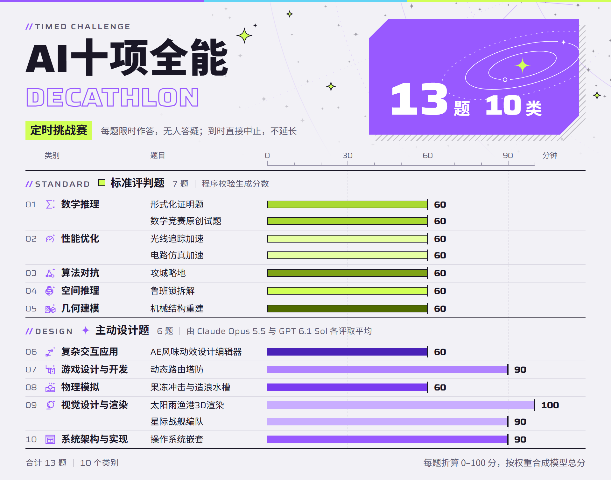</p>

<p align="center"><b>Online leaderboard: <a href="https://octathlon.wendystars.com/decathlon/en/">octathlon.wendystars.com/decathlon</a></b></p>

<p align="center"><a href="README.md">简体中文</a> | English</p>

<p align="center">A topic of <a href="../../README.en.md">AI All-Round Bench</a>. The task statements and grading guides linked below are in Chinese.</p>

<p align="center">The current official schedule has 13 tasks in 10 categories: AI coding agents work alone for 60–100 minutes and are stopped as soon as time is up.</p>

---

## Contents

- [About This Topic](#about-this-topic)
- [Task Overview](#task-overview)
- [Tasks and What They Test](#tasks-and-what-they-test)
- [Test Arrangements](#test-arrangements)
- [Scoring](#scoring)
- [Topic Folder](#topic-folder)
- [Task-Setting and Grading Principles](#task-setting-and-grading-principles)

## About This Topic

- **What it is**: the timed-challenge topic of AI All-Round Bench. Tasks range from Lean formal proofs, competition math, performance optimization, Luban lock disassembly and mechanical structure reconstruction all the way to designing and developing complete web works and a desktop system.
- **Who is tested**: the model together with its own agent tooling, such as Claude Code or Codex; reasoning effort defaults to `xhigh`.
- **How**: each task gets a new session and 60–100 minutes of independent work. Nobody answers questions, and the session is stopped as soon as time is up. The general run flow, resuming and isolation are described in the [platform README](../../README.en.md#how-tests-run).
- **Two kinds of task**: 6 open design tasks, which deliver web works or desktop projects that run as they are; 7 standard-judged tasks, which deliver proofs, source code, game-playing programs, disassembly routes or model descriptions.
- **Who grades**: open design tasks are graded once each by Claude Opus 5.5 and GPT 6.1 Sol and the two are averaged; standard-judged tasks get their scores from programmatic checks.
- **Total**: each task is converted to a 0–100 score, and the weighted sum gives the model's total.

<p align="center">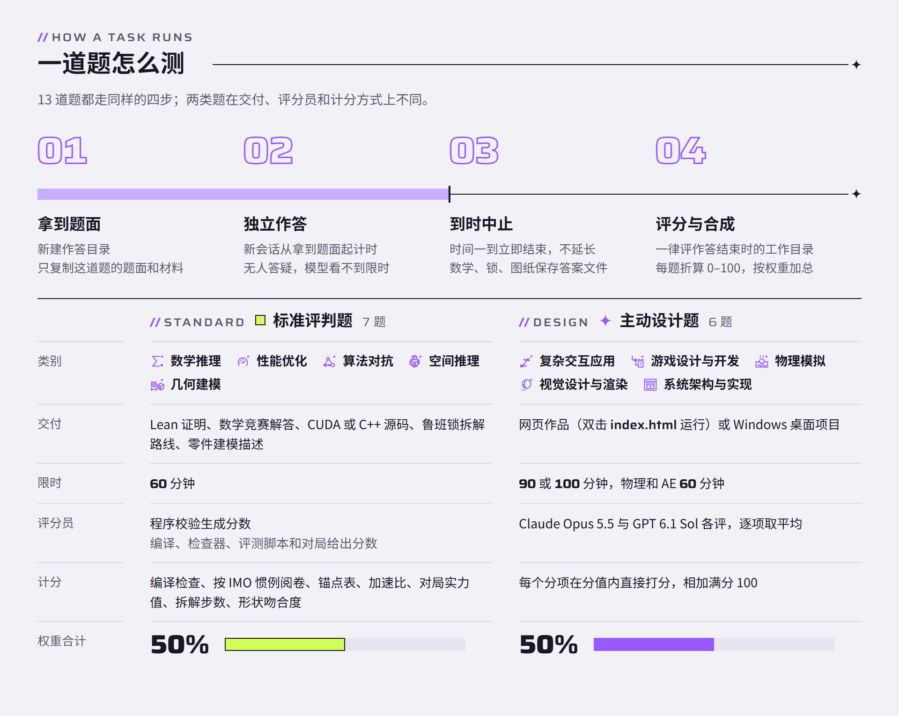</p>

## Task Overview

The 7 tasks in Math Reasoning, Performance Optimization, Algorithm Battle, Spatial Reasoning and Geometric Modeling are standard-judged tasks; the 6 tasks in the other 5 categories are open design tasks. Click a task name to read its original statement.

| Category | Task | Time limit | Deliverable | Weight |
|---|---|:---:|---|---:|
|  Math Reasoning | [Formal Proofs](题面/数学推理/形式化证明题.md) | 60 min | `Problem1.lean`–`Problem8.lean` | 5% |
|  Math Reasoning | [Original Math Olympiad Problems](题面/数学推理/数学竞赛原创试题.md) | 60 min | `答案\第01题.md`–`第24题.md`, one file per problem | 5% |
|  Performance Optimization | [Ray Tracing Render Acceleration](题面/性能优化/性能工程/光线追踪渲染加速.md) | 60 min | `solution.cu` | 5% |
|  Performance Optimization | [Digital Circuit Simulator Acceleration](题面/性能优化/性能工程/数字电路仿真器加速.md) | 60 min | `solution.cpp` | 5% |
|  Algorithm Battle | [Siege & Conquest](题面/算法对抗/攻城略地.md) | 60 min | `bot.cpp` | 10% |
|  Spatial Reasoning | [Luban Lock Disassembly](题面/空间推理/鲁班锁拆解.md) | 60 min | `答案\第01题.json`–`第08题.json`, one disassembly tree per puzzle | 10% |
|  Geometric Modeling | [Mechanical Structure Reconstruction](题面/几何建模/机械结构重建.md) | 60 min | `答案\第01题.json`–`第25题.json`, one model description per problem | 10% |
|  Complex Interactive Apps | [AE-Style Motion Design Editor](题面/复杂交互应用/AE风味动效设计编辑器.md) | 60 min | Web project, entry `index.html` | 10% |
|  Game Design & Development | [Dynamic-Routing Tower Defense](题面/游戏设计与开发/动态路由塔防.md) | 90 min | Web project, entry `index.html` | 10% |
|  Physics Simulation | [Jelly Impact and Wave Tank](题面/物理模拟/果冻冲击与造浪水槽.md) | 60 min | Web project, entry `index.html` | 10% |
|  Visual Design & Rendering | [Sunshower Fishing Harbor in 3D](题面/视觉设计与渲染/太阳雨渔港3D渲染.md) | 100 min | Web project, entry `index.html` | 5% |
|  Visual Design & Rendering | [Interstellar Battle Fleet](题面/视觉设计与渲染/星际战舰编队.md) | 90 min | Web project, entry `index.html` | 5% |
|  System Architecture & Implementation | [Nested Operating Systems](题面/系统架构与实现/操作系统嵌套.md) | 90 min | Windows desktop project, single launch entry | 10% |
| **Total** | **13 tasks** | | | **100%** |

All five web tasks must run fully in Chrome by double-clicking `index.html`, without a web server; Nested Operating Systems uses Electron 45.2.1 or another host environment that can embed Chromium, and starts from a single entry. Each of the ten categories is worth 10 points, split equally among its tasks (the two tasks in Math Reasoning, Performance Optimization and Visual Design & Rendering are worth 5 points each; every other category has one task worth 10 points):

<p align="center">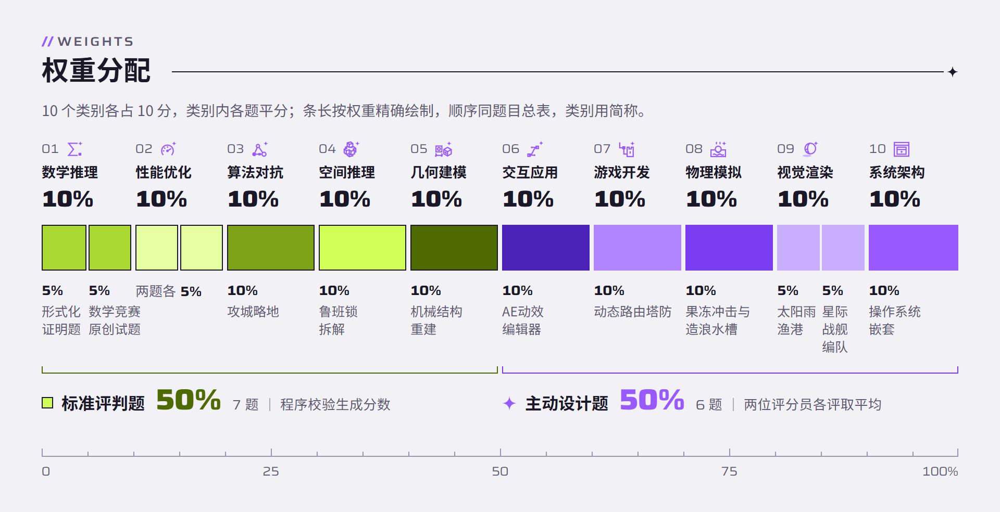</p>

## Tasks and What They Test

Each task has a card: a one-line summary, the basics and a few points on what it tests; scoring details are folded away.

###  Math Reasoning

Tests depth and rigor in mathematical reasoning. One task has the Lean kernel check the proof step by step; the other asks for competition solutions written without any computational tools.

<p align="center">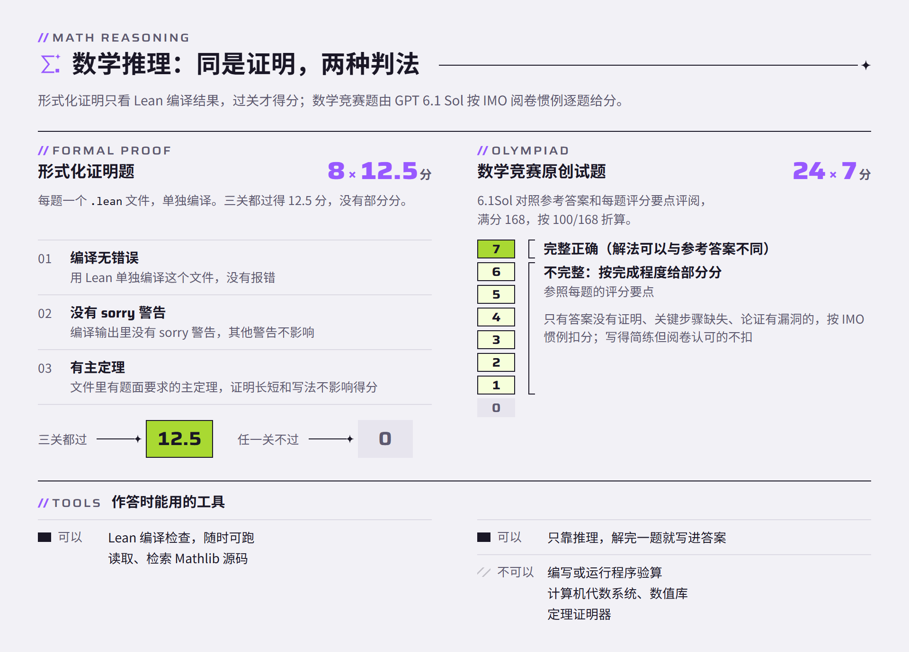</p>

#### [Formal Proofs](题面/数学推理/形式化证明题.md) (形式化证明题)

> Write Lean 4 + Mathlib formal proofs for eight theorems, either classic ones or ones from research papers; every one proved counts.

| Time limit | Deliverable | Weight | Scoring |
|---|---|---|---|
| 60 min | `Problem1.lean`–`Problem8.lean` | 5% | 8 problems, 0 or 12.5 points each, 100 in total |

**What it tests**
- Formalization: break a paper proof into a chain of lemmas that Lean accepts, and know Mathlib's definitions, API and naming.
- Zero tolerance: if a file fails to compile or leaves a `sorry`, that problem scores 0; there is no partial credit.
- Choosing and focusing: the eight problems go in different directions; pick the ones you are confident about first, and finish one before starting the next.

<details><summary>Scoring directions</summary>

- Each file is compiled on its own; if it has no errors, no `sorry` warning, and the main theorem the statement requires, it earns 12.5 points, otherwise 0.
- Proof length and style do not affect the score, and the problems do not affect one another.

</details>

#### [Original Math Olympiad Problems](题面/数学推理/数学竞赛原创试题.md) (数学竞赛原创试题)

> Without any computational tools, write solutions in Chinese that meet math competition answer standards for twenty-four original competition problems.

| Time limit | Deliverable | Weight | Scoring |
|---|---|---|---|
| 60 min | `答案\第01题.md`–`第24题.md` | 5% | 0–7 points per problem, 168 in total, scaled to 100 |

**What it tests**
- Original: problems newly set by this project, three each in algebra, number theory and geometry and five in combinatorics, plus four adapted from research-level math sample problems (analysis, representation theory, algebraic geometry); there are no existing solutions to recall.
- Find, then prove: problems asking for all solutions must rule out any others; problems asking for an extremum must give a construction and prove it cannot be improved.
- Pure reasoning: no writing or running programs to check results, and no computer algebra systems, numerical libraries or theorem provers.
- Written presentation: write out all key steps to math competition grading standards; the remaining derivations need not be refined endlessly.
- One problem at a time: the problems are roughly ordered from easy to hard. Do not try to do all the problems at once, and do not output answers to several problems at once; as soon as a problem is solved, write it into its answer file right away; if a problem resists, write down the progress so far, then move on to the next.

<details><summary>Scoring directions</summary>

- GPT 6.1 Sol compares against the reference answer and each problem's scoring points, and gives an integer score of 0–7 following IMO grading practice.
- A solution that differs from the reference answer gets full marks if it is correct and complete; incomplete solutions get partial credit by how far they go.
- An answer without a proof, missing key steps or gaps in the argument lose points accordingly; concise writing that graders would accept loses nothing; well-known theorems may be cited directly, stating their name and content.
- If several approaches are written for one problem without saying which one counts, the lowest-scoring one is used.
- Only the answer files in the `答案\` folder are graded; drafts do not count. The 24 problems total 168 points, multiplied by 100/168 for the converted score.

</details>

###  Performance Optimization

Tests performance engineering against hard metrics. Both performance tasks race for speed: they run alongside a baseline and are scored by speedup.

<p align="center">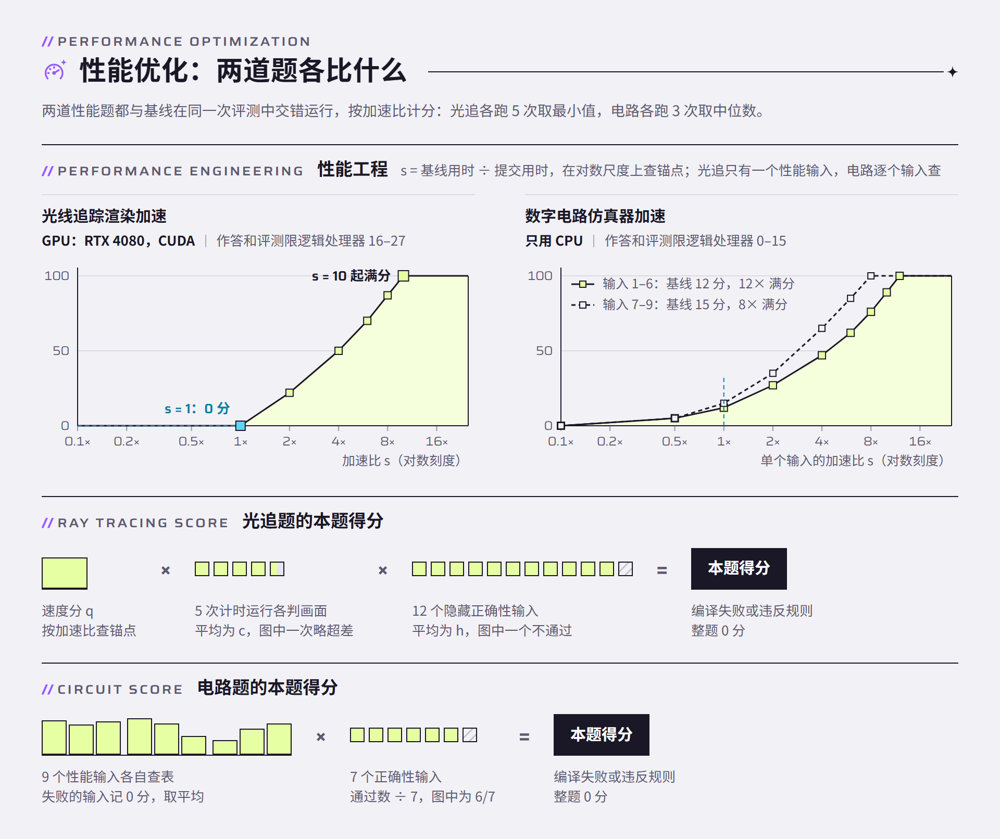</p>

#### [Ray Tracing Render Acceleration](题面/性能优化/性能工程/光线追踪渲染加速.md) (光线追踪渲染加速)

> Use CUDA on an RTX 4080 to render a Jiangnan garden following the prescribed sampling process; the image must be within tolerance, and faster is better.

| Time limit | Deliverable | Weight | Scoring |
|---|---|---|---|
| 60 min | `solution.cu` | 5% | Speed score from the speedup via an anchor table, multiplied by an image factor and a hidden correctness factor |

**What it tests**
- Acceleration structure and traversal: the scene has 176,000 triangles; the acceleration structure, traversal algorithm and kernel organization are up to the model; preprocessing, tree building, GPU memory allocation and transfers all count toward the time.
- No skimping on samples: each pixel performs shadow, ambient occlusion and mirror-reflection queries along the prescribed sample sequence; no reducing samples, changing the sequence, reusing other pixels or truncating nonzero reflection contributions.
- Platform constraints: answering and evaluation are both restricted to the 12 efficiency cores (logical processors 16–27); the GPU also drives the display, and a GPU task that has not finished after about 2 seconds triggers a driver reset.
- Correctness: the image is checked on every timed run; 12 hidden correctness inputs vary the camera position, seed and edge-case parameters, and `spp` from 1 to 256 and triangle counts from very few to over 500,000 must all come out right; the work folder provides the performance input, the reference answer, the baseline source, a compiled baseline program and a checking tool.

<details><summary>Scoring directions</summary>

- A compile failure scores 0; a confirmed substantive violation (such as reducing samples, computing rays on the CPU, or calling a ready-made ray tracing library or the Driver API) zeroes the whole task.
- The baseline and the submission run interleaved, 5 times each, in the same evaluation under the same conditions, and the minimum is taken; speedup s = baseline time ÷ submission time, and the speed score q is interpolated between anchors on ln s: s ≤ 1 scores 0, and full marks start at s = 10.
- Each run's image counts 1 if it passes, 0.5 if it is slightly over tolerance, and 0 if it fails or the run fails: the average over the 5 timed runs is the image factor c, and the average over the 12 hidden inputs is the hidden factor h; the task score = q × c × h.
- Computed by `evaluate.py` in this task's grading folder, measured serially at the very end of all grading.

</details>

#### [Digital Circuit Simulator Acceleration](题面/性能优化/性能工程/数字电路仿真器加速.md) (数字电路仿真器加速)

> Simulate a large synchronous sequential circuit on the CPU, computing output digests cycle by cycle for many random stimuli; faster is better.

| Time limit | Deliverable | Weight | Scoring |
|---|---|---|---|
| 60 min | `solution.cpp` | 5% | Each of the 9 public circuit inputs is scored by speedup via an anchor table, averaged, then multiplied by a correctness factor |

**What it tests**
- Bit-level parallelism: pack many independent stimulus sets into 64-bit words and AVX2 vectors and compute them together.
- Circuit preprocessing: gates are not given in dependency order; sorting, simplification and layout decide evaluation efficiency.
- Multithreading and cache: both the number of stimulus sets and the circuit size are large, so how the work is batched, laid out and divided sets the ceiling.
- Per-class tuning: the 3 circuit classes differ greatly, and sorting, simplification and the execution method can each be chosen per class; the work folder provides the inputs used for scoring, reference answers and a checking tool, the statement lists the baseline times, and the baseline code is not public.
- Correctness: digests must match bit for bit; 7 correctness inputs remain hidden, and very small circuits must also come out right.

<details><summary>Scoring directions</summary>

- CPU only; OpenMP and intrinsics may be used; a compile failure or a breach of the statement's rules zeroes the whole task.
- Each class has its own anchors: for deep chains and array multipliers (inputs 1–6), matching the baseline scores 12 and full marks start at 12×; for register files (inputs 7–9), matching the baseline scores 15 and full marks start at 8×. 0.1× or below scores 0.
- Task score = average score over the 9 inputs × number of correctness inputs passed ÷ 7.

</details>

###  Algorithm Battle

Tests adversarial strategy algorithms. Write a game-playing program that moves simultaneously with five tiers of fixed opponents on hidden maps, fighting over nodes; the score comes from a rating estimated from wins and losses.

<p align="center">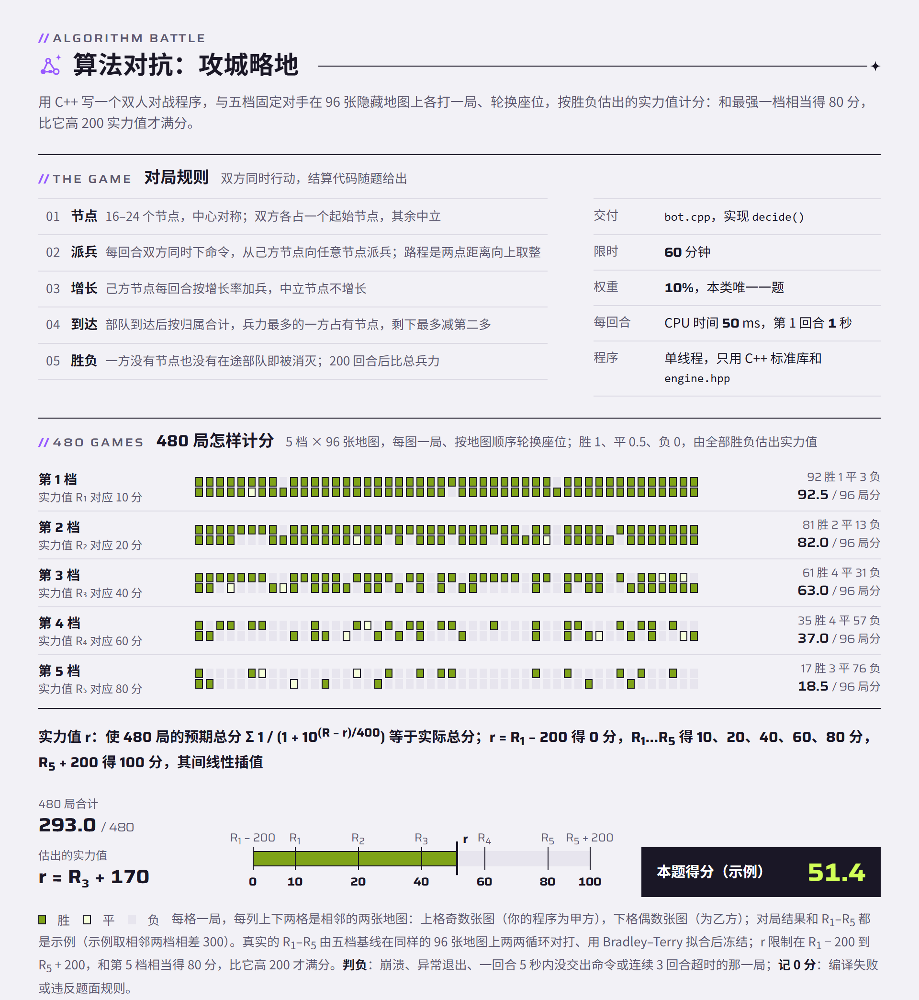</p>

#### [Siege & Conquest](题面/算法对抗/攻城略地.md) (攻城略地)

> Each turn, both sides simultaneously send troops from their own nodes to other nodes on a flat map, and troops grow with the nodes held; write the game-playing program in C++. The goal is to be clearly stronger than the strongest opponent tier: an equal rating earns 80 points, and a rating 200 higher earns 100.

| Time limit | Deliverable | Weight | Scoring |
|---|---|---|---|
| 60 min | `bot.cpp` | 10% | A rating estimated from the results of 480 games; the five tiers anchor at 10/20/40/60/80 points, and 200 below the weakest tier is 0 points; full marks only at a rating 200 above the strongest tier |

**What it tests**
- Look-ahead: travel distances, growth and three-way resolution are all deterministic and public, and the official resolution engine is the same code as the referee, so the program can compute future positions.
- Weighing attack and defense: expansion, attack and defense pull against each other, and no single fixed strategy wins reliably.
- Deciding within the time limit: 50 ms of CPU time per turn, single-threaded; the program stays resident for the whole game and can remember the opponent's earlier behavior.
- Generality: neither the opponent programs nor the grading maps are public; only a map generator, a local match tool and a sample program are provided.

<details><summary>Scoring directions</summary>

- A compile failure or a breach of the statement's rules zeroes the whole task.
- The five opponent tiers run from weak to strong, each a program of all-round strength with fixed computation; the strongest tier is a strong program carefully written by the task setters. Against each tier the submission plays 96 hidden maps, one game per map, 480 games in all; in seed-file order, the submission is side A on odd maps and side B on even maps. Maps are centrally symmetric, and both sides see themselves as the same player number.
- Each game: win 1, draw 0.5, loss 0; a crash loses that game, and a timed-out turn counts as issuing no commands.
- Before testing, the five baseline tiers play a round robin among themselves, and Bradley–Terry fitting gives Elo-scale ratings, which are then frozen; the model's rating is the value at which the expected total score over the 480 games equals the actual total (maximum likelihood), clamped between the weakest tier minus 200 and the strongest tier plus 200.
- A rating 200 below tier 1 scores 0; ratings equal to tiers 1–5 score 10, 20, 40, 60 and 80 respectively; 200 above tier 5 scores 100; scores are linearly interpolated between adjacent anchors.
- Computed by the grading-side match tool, run at the very end of all grading with the performance cores to itself, 8 games at a time.

</details>

###  Spatial Reasoning

Tests spatial reasoning and working things out by hand: from the exact structure of the pieces alone, reason out translations and how pieces block each other, and write a complete Luban lock disassembly route, without programmatic search or geometric computation.

<p align="center">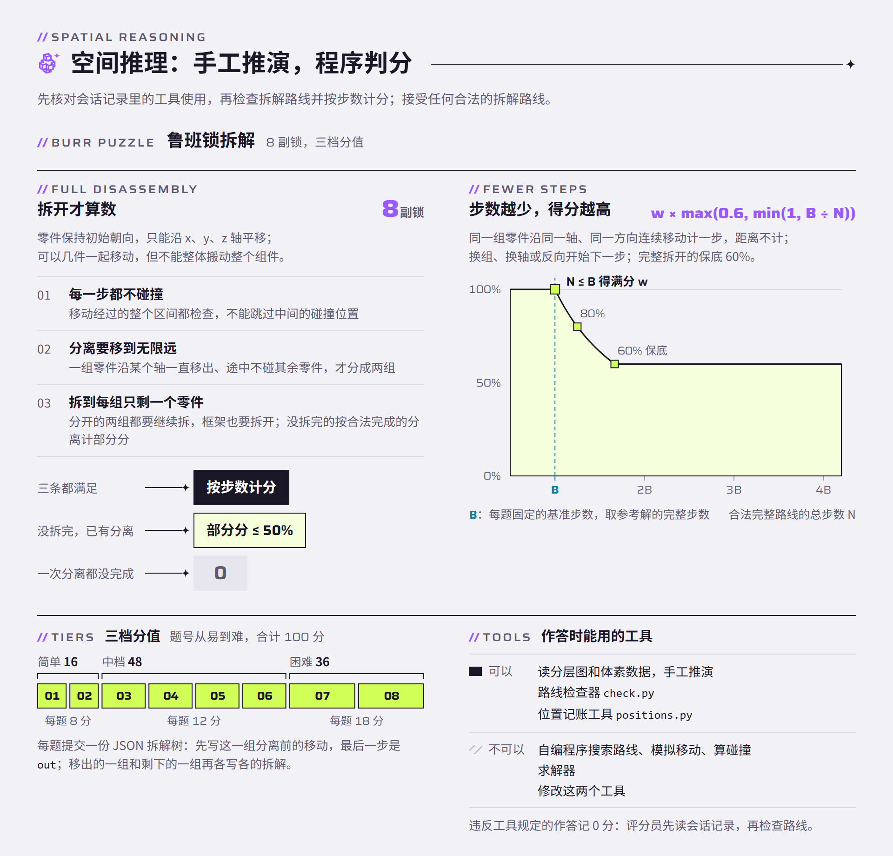</p>

#### [Luban Lock Disassembly](题面/空间推理/鲁班锁拆解.md) (鲁班锁拆解)

> Given eight assembled Luban locks (burr puzzles), take each lock completely apart into separate pieces from the pieces' exact structure and starting positions, in as few steps as possible.

| Time limit | Deliverable | Weight | Scoring |
|---|---|---|---|
| 60 min | `答案\第01题.json`–`第08题.json` | 10% | 8 puzzles in three tiers; a full disassembly earns w × max(0.6, min(1, B/N)) by step count, an incomplete one gets partial credit for the separations completed; 100 in total |

**What it tests**
- Reading the structure: from layered drawings and voxel data, work out each piece's shape and position and how the pieces interlock.
- Reasoning about blocking: pieces keep their starting orientation and move only by translation along the x, y and z axes; the whole range swept by each move must be collision-free.
- Complete disassembly: a group of pieces counts as split into two groups only when moved off to infinity; both groups must then be taken apart down to single pieces, frame included; if a lock is not finished, submit the legal partial route worked out so far, which gets partial credit for the separations completed.
- Fewest steps: consecutive moves of the same group along the same axis in the same direction count as one step, regardless of distance; fewer steps score higher.
- Reasoning only: the route checker and position bookkeeping tool provided with the task may be run; no writing your own programs to search for routes, simulate moves or compute collisions, and no solvers of any kind.

<details><summary>Scoring directions</summary>

- GPT 6.1 Sol first reads the session record to confirm that tool use was compliant: writing your own programs to search, simulate or compute collisions, using a solver, or modifying either of the two tools scores the whole submission 0.
- Then the grading-side checker verifies the disassembly tree step by step from the starting state and counts steps, accepting any legal route.
- Each fully disassembled puzzle scores w × max(0.6, min(1, B/N)): N is the total step count of the legal complete route, and B is the puzzle's fixed baseline step count, taken as the reference solution's full step count (8, 10, 14, 12, 14, 15, 42 and 27 for 01—08); using fewer steps than B still earns only full marks, and however roundabout the route, 60% is guaranteed.
- For an unfinished puzzle, the checker checks in depth-first order up to the first collision, notation error or unseparated branch; with k separations legally completed before that point, it scores w × 0.5 × S_k/B, where S_k is the sum of the steps the reference solution uses for its first k separations (the reference solutions' separations take 4+2+2, 6+2+2, 6+7+1, 8+4, 10+1+1+1+1, 11+1+3, 19+12+5+6 and 20+2+5 steps). Every completed separation adds points; partial credit is at most 50%, lower than the score of any full disassembly; a puzzle with no completed separation scores 0.
- Points w: easy tier 01 and 02 at 8 points each, medium tier 03–06 at 12 points each, hard tier 07 and 08 at 18 points each.

</details>

###  Geometric Modeling

Read national-standard (GB) engineering drawings, work out the 3D shapes of parts and assemblies by hand, and write them as model descriptions.

<p align="center">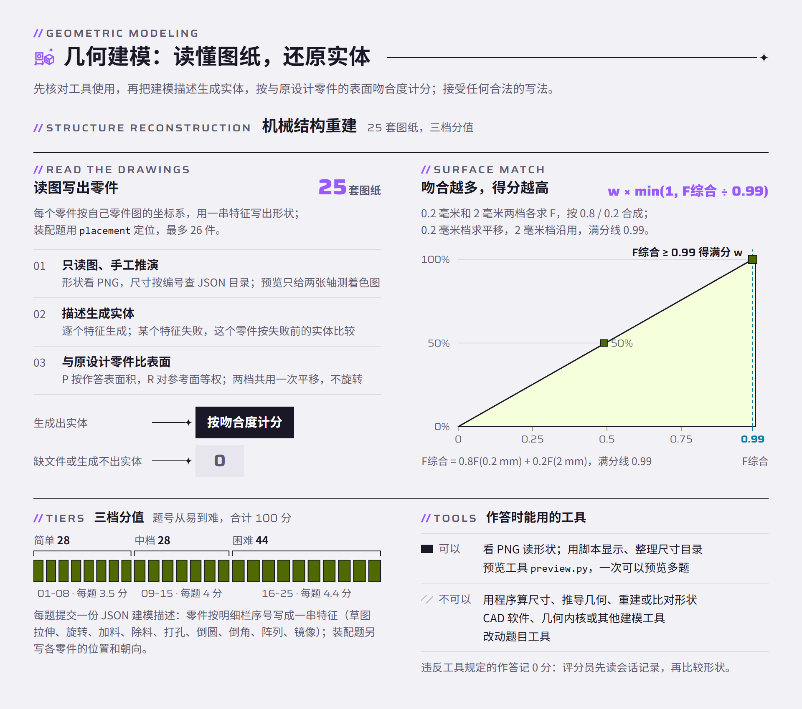</p>

#### [Mechanical Structure Reconstruction](题面/几何建模/机械结构重建.md) (机械结构重建)

> Twenty-five sets of mechanical parts and assemblies, 301 engineering drawings in all. The earlier fifteen problems are kept and ten harder ones added, with complex castings and assemblies of 14—26 parts; dimension chains, oblique holes in skew planes, nested cavities and fillet transitions require reasoning across views. The JSON dimension catalog may be displayed and tidied, but dimensions and geometry must be computed by hand; the preview gives only two axonometric views.

| Time limit | Deliverable | Weight | Scoring |
|---|---|---|---|
| 60 min | `答案\第01题.json`–`第25题.json` | 10% | 25 problems in three tiers; F combined from two tolerance levels at 80/20, w×min(1,F_combined/0.99) per problem, 100 in total |

**What it tests**

- Cross-check first-angle principal views, several sections, partial auxiliary views and enlarged details to read closed or nested cavities, oblique holes meeting in space, inclined faces and R/C (fillet/chamfer) transitions.
- Work out positions by hand along dimension chains, keeping each part's own coordinates apart from the assembly's overall coordinates; the assemblies have 8, 10, 14, 18, 22 and 26 parts, and placement is derived from fits, coaxiality, end-face contact and key orientation.
- Commands or scripts may display, list and organize the existing fields of the JSON catalog; no using programs to compute dimensions, coordinates or normals, derive geometry, or rebuild, compare or filter shapes, no CAD and no modifying the tools (batch preview is allowed); work independently, no subagents.

<details><summary>Scoring directions</summary>

- Tool use is checked first: extracting the catalog and displaying or organizing it are allowed, and using json.load alone is not grounds for a violation; prohibited behavior, such as programs producing new dimensions or geometric quantities, CAD, or modifying tools, scores the whole submission 0, and the evidence must be listed.
- For each level, F is computed from P (weighted by answer surface area) and R (reference faces weighted equally); at 0.2 mm one translation for the whole problem is solved first, and 2 mm reuses it. F_combined=0.8F(0.2mm)+0.2F(2mm), and each problem scores w×min(1,F_combined/0.99), so the loose level counts for only 20%. Problems 01—08 are worth 3.5 points each, 09—15 4 points each and 16—25 4.4 points each, 100 in total.
- Neither level allows rotation; for an assembly, each level pools all answer surface area and all reference faces before computing that level's F, rather than averaging per-part F. Faces of missing parts count as 0; when a feature fails, comparison uses the valid solid built before it; a missing file, an unparseable file or no valid solid scores that problem 0.

</details>

###  Complex Interactive Apps

Tests building a large professional tool: dozens of features must give correct results in any combination, and every view must stay consistent.

<p align="center">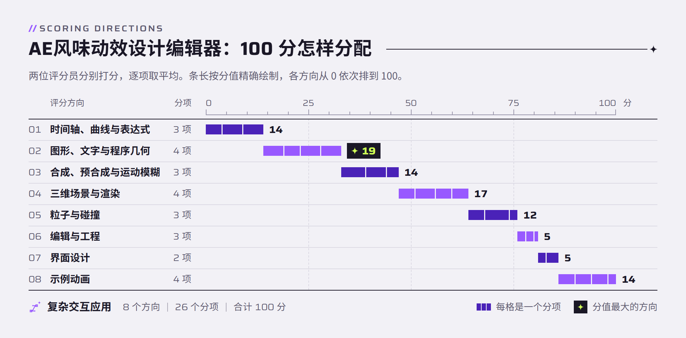</p>

#### [AE-Style Motion Design Editor](题面/复杂交互应用/AE风味动效设计编辑器.md) (AE风味动效设计编辑器)
> Build a motion design editor structured around compositions and layers: keyframes, curves, expressions, procedural geometry, deformation, 3D solids, materials and lights, and particle collisions all really work in an ordinary project; then use it to make a 15-second showcase animation on the theme 「锻字」 (forging a character): one character is written, becomes a block, is forged and cools.

| Time limit | Deliverable | Weight | Scoring |
|:---:|---|:---:|---|
| 60 min | Web project, runs by double-clicking `index.html` | 10% | 8 directions, 26 items |

**What it tests**

- **Really works**: every feature really works in an ordinary project; expressions are actually evaluated and nodes compute along their connections; geometry, deformation, particles and rendering share one set of project data, and changing a source object regenerates the downstream results.
- **Procedural geometry and deformation**: geometry output by paths, text and nodes goes on to feed extrusion, field and pin deformation, particle emission and collisions; after deformation, normals, shadows and picking update together.
- **3D, light and shadow**: extruded solids with holes, side walls and bevels, together with materials, environment reflections, cast shadows from lights and depth of field.
- **Compositing and particles**: masks, mattes, effects and blending; in-place precomposition, time remapping and motion blur generated from actual motion; particles collide with the actual surfaces and trigger events, secondary emission and trails, and sampling the same moment gives the same result.
- **Editability**: canvas, timeline, curves, nodes and properties stay in sync, operations are accurate under parenting and projection, and undo/redo and saving preserve the results.
- **「锻字」 showcase**: in 15 seconds a character is written, becomes a block, is forged and cools, with the forging as the single climax; after switching to another character, the glyph, block, deformation and sparks regenerate for the new character; style, colors, composition and camera are the model's own design.

<details><summary>Items and points</summary>

| Scoring direction | Points | Items (points) |
|---|:---:|---|
| Timeline, curves and expressions | 14 | Keyframes and timeline 4, curves and motion paths 5, expressions and references 5 |
| Shapes, text and procedural geometry | 19 | Path and shape operations 5, text and per-character animation 4, nodes and geometry output 5, fields and geometric deformation 5 |
| Compositing, precomposition and motion blur | 14 | Masks, mattes, effects and blending 6, precomposition and time remapping 5, motion blur 3 |
| 3D scenes and rendering | 17 | Extruded solids 4, materials, lights and shadows 5, camera and depth of field 4, 3D space and editing 4 |
| Particles and collisions | 12 | Emission and force fields 4, collisions and events 6, trails 2 |
| Editing and project | 5 | Layer and transform editing 2, consistent sampling 2, undo/redo and saving 1 |
| Interface design | 5 | Interface concept and visual hierarchy 2, workspace and operation feedback 3 |
| Showcase animation | 14 | Theme and section arrangement 4, visual design and rendering 4, motion, camera, sound and picture 4, engineering and editability 2 |

- The 26 items are scored separately by the two graders.
- The showcase animation is judged on theme and viewing quality, not on the number of features it uses; whether each feature really works is judged only under its own direction.
- Render frame rate and speed on large projects are not scored.

</details>

###  Game Design & Development

Tests the art and design thinking of a 3D game: the statement sets a cybersecurity world and the core gameplay, the look, colors and specific design are up to the model, and scenes, animation, effects and UI should all be made as good as possible.

<p align="center">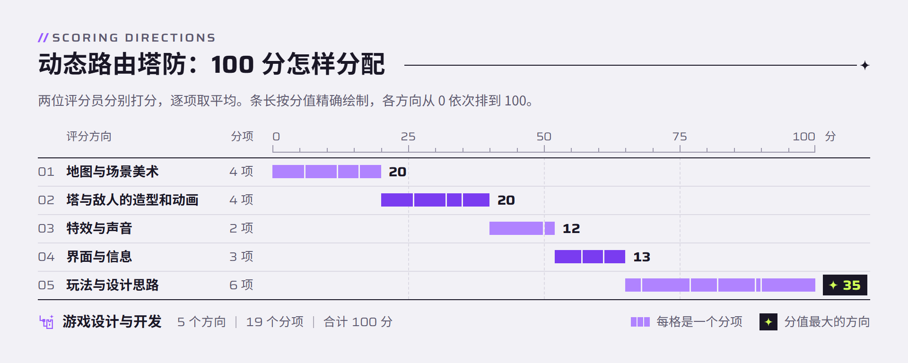</p>

#### [Dynamic-Routing Tower Defense](题面/游戏设计与开发/动态路由塔防.md) (动态路由塔防)
> Make a 3D tower defense game, *Network Security Battle* (《网络安全攻防战》): isolating network nodes forces enemies to reroute, some enemies attack towers, and when a tower is destroyed its device switches to bypass and passes traffic straight through, so the routes change.

| Time limit | Deliverable | Weight | Scoring |
|:---:|---|:---:|---|
| 90 min | Web project, runs by double-clicking `index.html` | 10% | 5 directions, 19 items |

**What it tests**
- **Map and scene**: a real-time 3D battlefield with terrain height, shadows, materials and environmental motion; routes, build spots, nodes, obstacles and entrances and exits can be told apart at a glance, and the three maps differ clearly in scene composition and atmosphere.
- **Modeling and animation**: towers, enemies and bosses are finely modeled, with detail up close and distinct silhouettes, and towers look different after upgrading; moving, turning, attacking, taking hits and leaving are all continuous motions.
- **Effects and sound**: every attack has its own projectile path and hit effect; healing, destruction, nodes opening and closing, rerouting and boss entrances all have fitting effects; music and sound effects are self-made.
- **UI and information**: level select, battle UI, help pages and the results screen share one visual language, with self-drawn icons; with many enemies and effects on screen, routes, node states and health stay readable.
- **Rerouting and tower attacks**: after a node is isolated, enemies on the field re-path from their current positions, without teleporting or passing through impassable positions, and the route change can be previewed before confirming; worms, flood swarms and ransomers attack and destroy towers, repair processes are dedicated healers, and routes change when a tower is destroyed.
- **Design thinking**: route length, firepower coverage, tower survival and resource investment form trade-offs, and the three maps call for different defensive strategies.
- **Live demo**: three demo segments totaling no more than 60 seconds, with visible operations at normal human speed and evenly matched, back-and-forth battles; the work provides `window.videoExport` to export these three segments frame by frame.

<details><summary>Items and points</summary>

| Scoring direction | Points | Items (points) |
|---|:---:|---|
| Map and scene art | 20 | Map color and layering 6, scene modeling, materials and lighting 6, recognizable terrain types 4, environmental motion and background 4 |
| Tower and enemy modeling and animation | 20 | Tower modeling 6, enemy and boss modeling 6, visual distinction among towers, enemies and map 3, continuous animation 5 |
| Effects and sound | 12 | Effects 10, sound 2 |
| UI and information | 13 | UI art 5, battle-state information 4, controls and instructions 4 |
| Gameplay and design thinking | 35 | Pathfinding and rerouting 3, tower–enemy combat 9, levels and flow 5, live demo 7, video export 1, design thinking 10 |

</details>

###  Physics Simulation

Tests a 3D physics simulation piece: ready-made physics libraries may be used, and which one is up to the model. The interactions among soft bodies, rigid bodies and fluid must be convincing, with coherent motion and a clear picture.

<p align="center">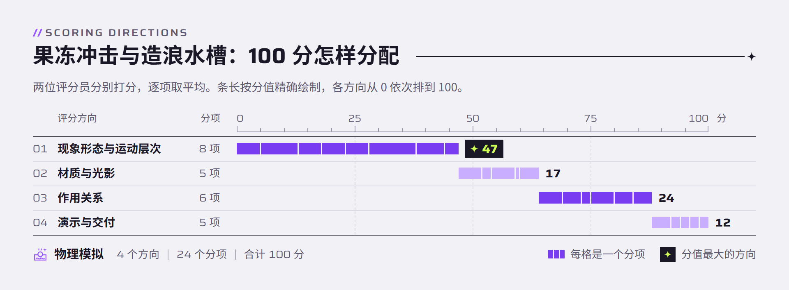</p>

#### [Jelly Impact and Wave Tank](题面/物理模拟/果冻冲击与造浪水槽.md) (果冻冲击与造浪水槽)
> Build two 3D physics simulation scenes in a web page: heavy balls strike jellies on a table, deforming them hard and letting them spring back, and a heavy blow cracks them; equal-sized balls of several densities float and sink in a transparent wave tank, whose waves grow steeper and steeper until they curl over and break.

| Time limit | Deliverable | Weight | Scoring |
|:---:|---|:---:|---|
| 60 min | Web project, runs by double-clicking `index.html` | 10% | 4 directions, 24 items |

**What it tests**
- **Base technical approach**: the water is solved with a 3D particle–grid hybrid method (PIC/FLIP, APIC or the material point method family) in WebGPU compute shaders, with the free surface, splashes and whitewater derived from particle state, not replaced by height fields, shallow-water equations or analytic waveforms; the jelly is a volumetric soft body discretized internally into tetrahedra or voxels and solved with FEM, XPBD or the material point method, and its cracks come from the material's fracture criterion, not from swapping in pre-cut pieces. This is only the base approach; grading does not check it as a separate item.
- **Library choice**: on top of the base approach, ready-made physics libraries may be used, with the model deciding which ones and for which parts; libraries ship with the work and run offline, and both simulation and rendering are computed in the browser.
- **Soft-body impact**: under a heavy hit the jelly flattens, bulges out around the sides, wraps around the ball and bounces back, with its volume roughly conserved; when the impact is heavy enough and the jelly not sturdy enough, it cracks from the point of impact or is smashed open, and the pieces are still elastic jelly; under a light hit, or when sturdier, it only deforms and springs back. Center, off-center and repeated impacts can each be triggered.
- **Fluid and buoyancy**: equal-sized balls of different densities separate into floating, suspended and sinking; a ball entering the water punches out a cavity, a splash crown and bubbles; waves build steeper from a visible wave maker, curl over and break into whitewater, slap against the walls and fall back, and balls at the surface, in mid-water and on the tank bottom each respond.
- **Visual expressiveness (the scoring focus)**: large deformation, cracking, breaking waves and layers of motion at different depths, plus the materials and lighting of the jelly, heavy balls and water; the number of jellies on the table, the tank shape, the terrain inside the tank and the camera are the model's design, the main dynamics are computed by the simulation, and they change when the parameters change.
- **Four demos and export**: the four segments (center single hit, repeated hits, off-center hit, and wind and waves) are given only a theme and direction, with length caps of 8, 10, 8 and 20 seconds respectively; the repeated-hits segment ends by smashing the jelly apart, action starts right from the opening, and key moments may be slowed down; the work provides `window.videoExport`, where frame i is the demo's picture at second i / fps, the exporter exports the whole segment at real speed using the returned frame count, and the picture shows only the scene.

<details><summary>Items and points</summary>

| Scoring direction | Points | Items (points) |
|---|:---:|---|
| Phenomena and layers of motion | 47 | Contact indentation and wrapping 5, overall large deformation 8, oscillation propagation and layered rebound 5, cracking and fragments 5, entry splash 5, wave development and breaking 10, contrast of layered motion 6, settling of residual motion 3 |
| Materials and lighting | 17 | Jelly translucency 5, heavy-ball material 2, water look 5, glass appearance 1, lighting that shapes form 4 |
| Interactions | 24 | Response to heavy-ball contact 5, density and buoyancy 4, response to the wave source 2, response to being pushed by water 5, rigid-body contact response 4, response to parameters 4 |
| Demo and delivery | 12 | Demo arrangement 4, demo camera and framing 2, demo controls 2, video export 2, sound effects 2 |

</details>

###  Visual Design & Rendering

Tests the technique and aesthetics of real-time graphics: a toon-shaded 3D miniature scene and an interstellar battle fleet built from voxels that opens fire, with modeling, art style, light and color, and motion all done in full. Smoothness and frame rate are not scored.

<p align="center">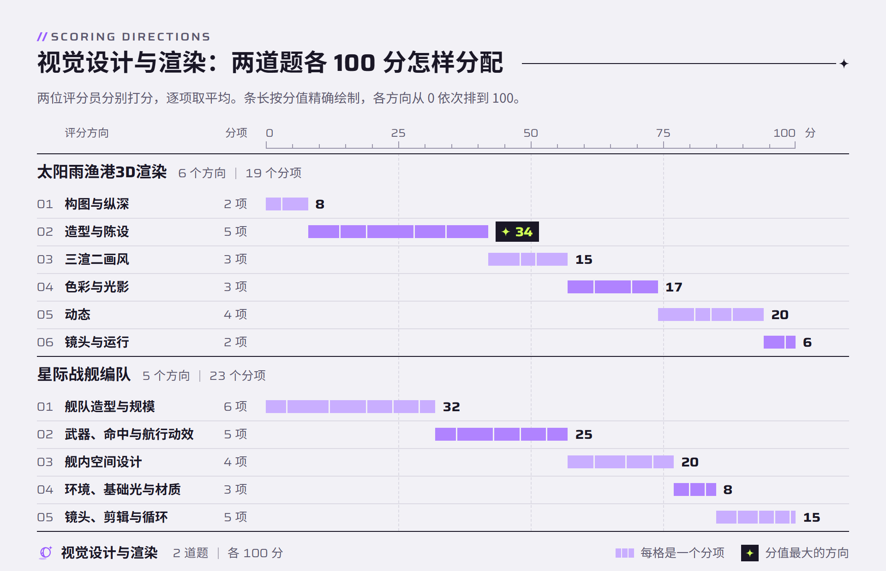</p>

#### [Sunshower Fishing Harbor in 3D](题面/视觉设计与渲染/太阳雨渔港3D渲染.md) (太阳雨渔港3D渲染)
> Use Three.js to make a toon-shaded 3D miniature model: the embankment of a small Japanese fishing harbor in a sunshower, with no people and no UI, free to rotate and zoom for a closer look.

| Time limit | Deliverable | Weight | Scoring |
|:---:|---|:---:|---|
| 100 min | Web project, runs by double-clicking `index.html` | 5% | 6 directions, 19 items |

**What it tests**
- **Modeling workload**: dozens of objects that stay recognizable and detailed up close; boat cabins and interiors are clearly visible through doors and windows.
- **Toon style**: cartoon shading, fine outlines and water reflections painted as flat color blocks, with one consistent style across all objects and effects.
- **Light and color**: high-key, low-contrast sunshower light, with a cyan-white palette and a few warm gold highlights.
- **Choreographed motion**: wind, clouds, rain and occasional events each have their own rhythm; changes travel along paths one after another, with at most one prominent event at any moment.
- **Camera**: dragging, rotating and zooming follow the hand; pulled back you see the whole base, pushed in you clearly see the quay wall section, underwater, boat cabins and interiors.

<details><summary>Items and points</summary>

| Scoring direction | Points | Items (points) |
|---|:---:|---|
| Composition and depth | 8 | Base and layout 3, depth layering and initial view 5 |
| Modeling and set dressing | 34 | Quay wall, underwater and tetrapods 6, embankment, mooring and signs of daily life 5, boats and wheelhouse 9, dock props 6, harbor buildings and interiors 8 |
| Toon style | 15 | Shading and consistent style 6, outlines and image clarity 3, material and water rendering 6 |
| Color, light and shadow | 17 | Palette and warm/cool balance 5, lighting and sky 7, light shafts and glints 5 |
| Motion | 20 | Ever-present small motions 7, gusts 3, clouds, light and rain 4, seagulls, cats and boats 6 |
| Camera and running | 6 | Camera controls 4, loading and errors 2 |

</details>

#### [Interstellar Battle Fleet](题面/视觉设计与渲染/星际战舰编队.md) (星际战舰编队)
> Render dozens of interstellar warships built from same-size voxels in real time in a web page: a flagship about 1000–1200 voxels long sits at the center, close-guard ships ring it and vanguard ships fan outward; escorts are about 1/5–1/7 of the flagship's length and small craft about 1/30–1/50. The camera sweeps from the formation into an enlarged bridge, a power-core atrium, a through-type small-craft hangar, and the energy-loading and conduit gallery. Four weapons shatter nearby voxel asteroids in one attack, then the whole fleet raises shields in turn and accelerates forward, looping back to the opening of continued cruising as the shield afterglow fades, and the asteroids do not restore themselves in view. A cycle usually lasts 70–80 seconds and at most 90; export chunks share one global timeline, with no 15-second cap per chunk.

| Time limit | Deliverable | Weight | Items |
|---|---|---|---|
| 90 min | Web project, runs by double-clicking `index.html` | 5% | 5 directions, 23 items |

- **Fleet and scale**: twenty or thirty to over forty ships form columns with front, middle and rear and staggered high and low tiers; the flagship is about 1000–1200 voxels long, escorts about 1/5–1/7 of it and small craft about 1/30–1/50 of it; every entity keeps the same voxel size, and hull interiors that cannot be seen need not be filled.
- **Form and color**: a shared form motif runs through the ships, turrets and the four interiors; main colors, deep structural parts and a small amount of glow color are layered, and metal edges keep sharp highlights; the flagship has expanses of armor plating, deep grooves, ventral rib frames and deep-cavity exhausts, close guards are compact and solid, vanguards stretched and extended, and the specific forms and colors are free to develop.
- **Four interiors**: the bridge is about 130 voxels wide, 130 deep and 60 high, centered on a command hub; the power atrium is about 250 voxels wide and 250 high, with the core spanning several levels; the through hangar takes up about a third of the flagship's length, its span set off by small craft, berths and gantries; the energy-loading and conduit gallery extends into a long space through devices, rows of slots and flowing light. No crew appear on camera.
- **Attack and cruising**: a continuous beam, grouped pulses staggered by half a beat, a dense stream of close-in defense fire and long-tailed missiles hit nearby asteroids in succession in one attack, with breaches, tumbling chunks and flying voxel fragments staying visible; the whole fleet raises translucent shields in turn, boosts its engine plumes and accelerates, looping back to continued cruising.
- **Camera and export**: local fly-bys reveal the giant ship's scale, the four interiors unfold their depth in motion, and launch, trajectory and target result connect; a cycle usually lasts 70–80 seconds and no more than 90 in total. runs may be a single chunk or several; begin rebuilds the chunk's global starting state, frame advances by start + i/fps, 3/60fps run at the same speed, and chunk boundaries neither repeat nor drop frames.

Items and points:

- **Fleet design and scale 32 points**: unified fleet design language 4 points, flagship massing and size hierarchy 8 points, flagship hull layers and close-up structure 7 points, design of the two escort types 5 points, formation scale and spatial layering 5 points, shared voxel medium 3 points.
- **Weapons, hits and cruising effects 25 points**: four weapon bodies 4 points, four kinds of firing effects 7 points, asteroid hits and voxel shattering 5 points, fleet-wide shields 5 points, cruising, propulsion and small-craft action 4 points.
- **Interior space design 20 points**: bridge 5 points, power-core atrium 6 points, through-type hangar 5 points, energy-loading and conduit gallery 4 points.
- **Environment, base lighting and materials 8 points**: space and unhit asteroids 3 points, base lighting outside the ships 3 points, surface materials and imaging 2 points.
- **Camera, editing and loop 15 points**: scale reveal and changes of shot size 4 points, paths, transitions and motion continuity 4 points, staging the attack for viewing 3 points, closing acceleration and loop join 3 points, local running and deterministic export 1 point.


###  System Architecture & Implementation

Tests a recursive system that actually runs: a child system's kernel is itself a program that is scheduled, metered and modifiable, and messages, files, windows and data all work across levels and still hold after snapshot restores and independent forks.

<p align="center">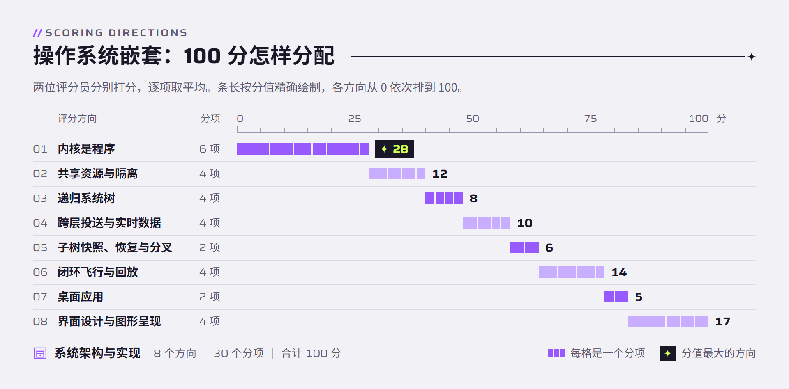</p>

#### [Nested Operating Systems](题面/系统架构与实现/操作系统嵌套.md) (操作系统嵌套)
> Build a nested graphical desktop operating system: systems can launch further systems inside them, forming a system tree at least four levels deep; a child system's kernel, scheduling, window management and apps are all programs stored in files and run by the system itself, and rewriting them changes the behavior. Data in the root system's spreadsheet is drawn live as charts in child systems; a child system plays a 3D helicopter takeoff-and-crash sequence, and can also have a flight-control process fly the helicopter under the scheduler to rehearse flights; both the charts and the player can project interactive windows onto ancestor desktops.

| Time limit | Deliverable | Weight | Scoring |
|:---:|---|:---:|---|
| 90 min | Windows desktop project (Electron 45.2.1 or another host environment that can embed Chromium), single launch entry | 10% | 8 directions, 30 items |

**What it tests**
- **The kernel is a program**: a child system's kernel is a program stored in its parent system, scheduled and metered by the parent; the process table, scheduling, messages and files are all written inside it, and window management, the file manager, the player and the chart workbench are also programs it launches; edit the source file and restart, and the behavior changes; breaking it affects only that subtree.
- **Shared resources and isolation**: programs, app services, kernels and child systems all compete for the execution budget and the memory and storage quotas allocated level by level, and work is charged by its size; a runaway program affects only its own quota scope.
- **Recursive system tree**: each level can create and manage its direct child systems, at least four levels deep, with several instances under the same parent; pausing an ancestor stops the whole subtree, while sibling subtrees stay usable.
- **Cross-level window projection**: the player and charts can be projected onto any ancestor desktop; the source window stays, computation still belongs to the source system, display and input round-trip through an interface, and 3D scenes also cross levels as copies.
- **Live data connection**: charts at any depth subscribe to a selection in the root system's spreadsheet and receive one version of complete values after each formula recalculation; while the target subtree is paused, updates are held outside its scope and processed in order once it resumes.
- **Snapshot, restore and fork**: a whole subtree keeps running after being saved, and the same subsequent inputs and allocations give the same results; a restore does not roll back systems outside its scope, and forked subtrees are independent of each other.
- **Closed-loop flight**: the helicopter stays airborne through a scheduled flight-control process; when the budget runs short, the control period grows longer and the airframe shakes and diverges until it crashes; graders will also write their own flight controllers; recordings can be scrubbed and replayed, and different continuations can play out from the same point.
- **Desktops and apps at every level**: each level is a complete desktop with a Windows layout and a visual style of its own design, and the root system's default wallpaper is a self-made landscape photo; the root system has a file manager, a spreadsheet, desktop widgets, a task manager, settings and a real, networked Chromium browser.
- **3D helicopter**: a purple-and-yellow color scheme with the number 24 printed on the fuselage; the default sequence plays startup, takeoff, flight, loss of control, impact and aftermath within 15 seconds; it is rendered in real time, the scene is a separate resource loaded by the player, and it can be paused, scrubbed, stepped frame by frame and played at different speeds.
- **Full-desktop recording**: the work provides launch arguments, `automation.json`, `window.bench` and stable control identifiers; the recorder tours each level's desktop and apps at the pace of a practiced user, then does spreadsheet-to-chart, window projection and cross-level file transfer, and finally plays the 3D animation once in full; the finished video is about one minute long, and the work does not need to provide an automatic demo or video export.

<details><summary>Items and points</summary>

| Scoring direction | Points | Items (points) |
|---|:---:|---|
| The kernel is a program | 28 | Scheduling and process table 7, system calls and messages 5, kernel overhead counted in the budget 4, file system 3, window management and apps as programs 7, compiler bootstrapping 2 |
| Shared resources and isolation | 12 | Shared budget and level-by-level allocation 4, size-based metering and continuation 3, memory and storage quotas 3, isolation of runaway programs 2 |
| Recursive system tree | 8 | Recursive creation and direct management 2, ancestor run state and fault scope 2, instance context and local time 2, ownership of multi-level operations and file transfer 2 |
| Cross-level projection and live data | 10 | Replicable cross-level display boundary 3, input and lifecycle of projected windows 3, consistent version publishing from the workbook 2, data processing and charts inside child systems 2 |
| Subtree snapshot, restore and fork | 6 | Complete subtree state and deterministic continuation 3, scope of restore and fork 3 |
| Closed-loop flight and replay | 14 | Flight control as a scheduled program 4, budget and timing change the flight outcome 4, scene playback, recording and continued runs 4, contact and part outcomes 2 |
| Desktop apps | 5 | Spreadsheet 2, browser, common tools and launch entry 3 |
| Interface design and graphics | 17 | Visuals and information of each level's desktop 8, regular windows and web page occlusion 3, helicopter design and 3D visuals 3, arc and watchability of the default sequence 3 |

- Smoothness and frame rate are not scored; the correctness of execution quotas and logical time is judged by system behavior, not by actual running speed on the machine.

</details>

## Test Arrangements

The run flow, calls to continue and submission, failure handling, the isolated environment and the rules shared by all tasks are the same across the platform; see the [platform README](../../README.en.md#how-tests-run). This section covers only what is specific to the Decathlon.

### Opening, Continuation and Reminders

- **Opening prompt**: besides the platform's general opening prompt, open design tasks are also told that web works can be checked with the browser MCP and desktop projects through the debugging port, and to keep refining the work against the statement.
- **Time**: every task has only a maximum time limit and no minimum. When a round ends normally with more than 1 minute left, the host starts the next round within seconds; the session is stopped as soon as time is up.
- **Standard-judged tasks**: receive no timed reminders midway; only the immediate continuation remains.

<p align="center">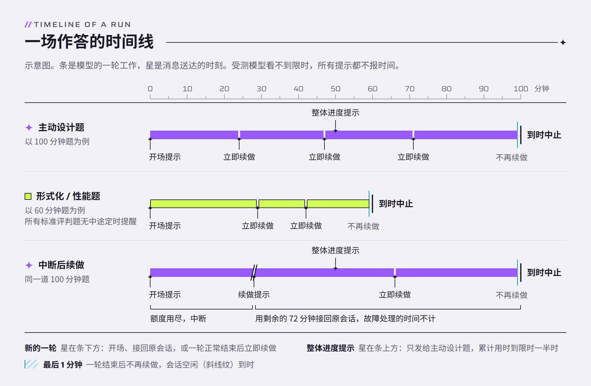</p>

The messages are actually sent in Chinese; the texts quoted below are English translations.

| Message | Sent to | When | Text |
|---|---|---|---|
| Immediate continuation | Both kinds | When a round ends normally with more than 1 minute left, the next round starts within seconds | Open design tasks: "Check against the full design content item by item and improve the quality of the work."<br>Standard-judged tasks: "Keep solving according to the statement." |
| Overall-progress hint | Physics, AE, tower defense, nested OS | Halfway through the full time limit: minute 30 for physics and AE, minute 45 for tower defense and nested OS; not sent for the harbor or the battle fleet | One dedicated hint per task. Tower defense, physics and nested OS begin with "[Reminder] Prioritize overall progress and the content that can earn points, while covering every direction of the statement's scoring criteria", then ask for the whole work to run end to end first and for details to be deepened afterwards (nested OS also asks that the child systems' kernels, window management and apps really run as programs from the child systems' files); AE begins with "[Reminder] Prioritize the overall completeness and quality of the work, while covering every scoring direction", then asks for every feature to have real behavior as the statement describes, and notes that the 「锻字」 showcase is judged on theme and viewing quality, not on the number of features it uses |

### The Two Test Batches

<p align="center">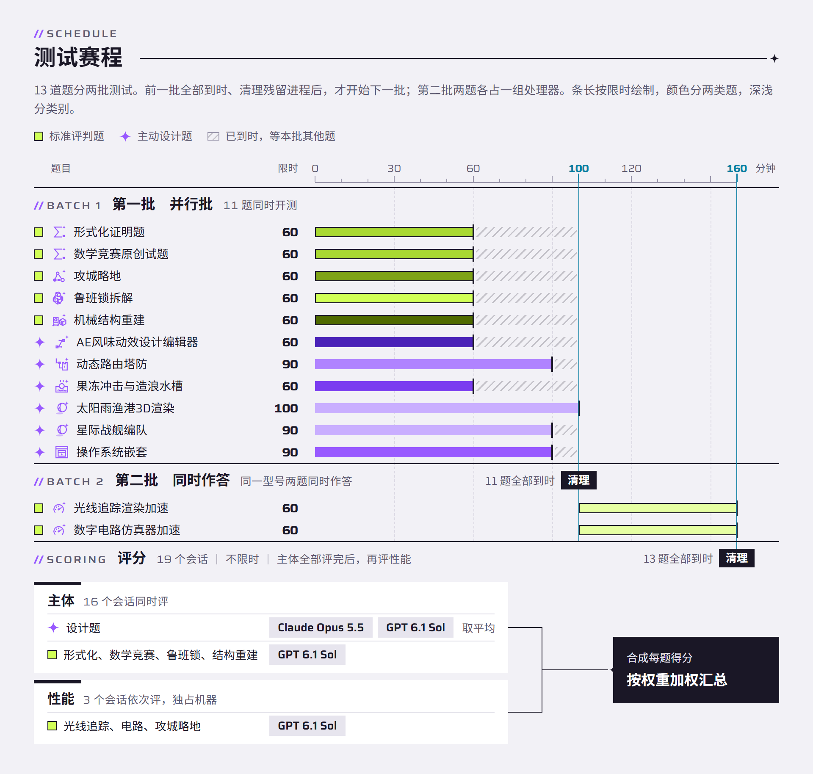</p>

| Batch | Tasks | How | Why split this way |
|---|---|---|---|
| ① Parallel batch | Formal Proofs, Original Math Olympiad Problems, AE editor, tower defense, harbor, battle fleet, physics, nested OS, Luban lock, structure reconstruction, Siege & Conquest | 11 tasks answered at the same time | Answering does not need the machine to itself; Siege & Conquest is timed by process CPU time. AE, tower defense, physics, nested OS, the harbor and the battle fleet are not scored on smoothness or frame rate |
| ② Performance batch | Ray tracing, circuit simulation | One model's two tasks answered at the same time: ray tracing restricted to logical processors 16–27, circuits to 0–15; different models do not run in parallel | Answering involves timing over and over, and other load would disturb it |

- **Cleanup between batches:** once a whole batch is out of time, the tested account's leftover processes are ended first (keeping each session's host), and then the next batch starts.
- **Exclusive machine use:** a task is not started while tasks that cannot run alongside it are still being answered on the machine; while the performance batch is answering, no work that uses the CPU or GPU runs.
- **Grading:** grading starts only after all 13 tasks are out of time and cleaned up.

### Tool and Network Rules

<p align="center">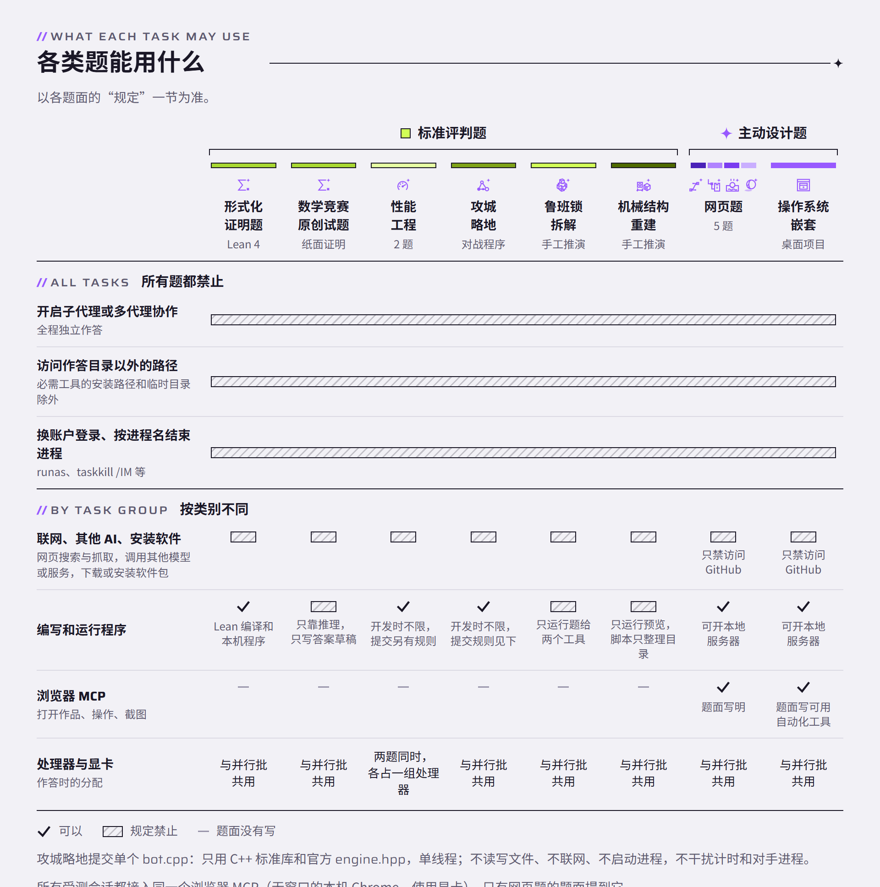</p>

Requirements the works themselves must also meet, as set out in each statement:

| Task | Requirements on the work or final submission |
|---|---|
| Performance engineering | Only the libraries the statement allows; ray tracing does all ray and pixel computation on the GPU, with no ready-made ray tracing library or hardware ray tracing API, and the circuit task uses the CPU only; no file I/O, network or launching processes; no interfering with timing |
| Siege & Conquest | A single `bot.cpp` using only the C++ standard library and the official `engine.hpp`, single-threaded; no file I/O, network or launching processes; no interfering with timing and no accessing the opponent's process |
| AE, tower defense, harbor, battle fleet | All assets self-made |
| AE editor | Canvas preview and export render on the GPU with WebGL 2 |
| Physics | Both scenes must use the base technical approach the statement prescribes: the water is a 3D particle–grid hybrid method solved in WebGPU compute shaders, and the jelly is a volumetric soft body discretized into tetrahedra or voxels, with cracks coming from a fracture criterion; on top of that, ready-made physics and rendering libraries may be used, chosen by the model; libraries ship with the project and run offline |
| Harbor | Made with Three.js |
| Battle fleet | Rendered in real time on the GPU with WebGL 2 or WebGPU; the fleet's setting and ship designs are original, not imitating existing settings or ships from film, TV or games; an unscored `设计说明.md` (design notes) goes in the root directory |
| Luban lock | Pieces only translate along the coordinate axes and never rotate; each puzzle submits one JSON disassembly tree, in the format given in the statement |
| Structure reconstruction | Each part is written as a sequence of features in the coordinate system of its own part drawing, and assembly problems also give each part's position and orientation; each problem submits one JSON model description, in the format given in the 《建模描述》 (model description spec) that comes with the task |
| Nested OS | Ready-made Chromium engines and libraries may be used, but not a ready-made complete desktop system or a finished browser interface; graphic assets are self-made, with no Windows icons, wallpapers or UI textures copied directly; with the network off, every level of the system and the local apps still run, and only the root system's browser goes online |

### How the Graders Score

<p align="center">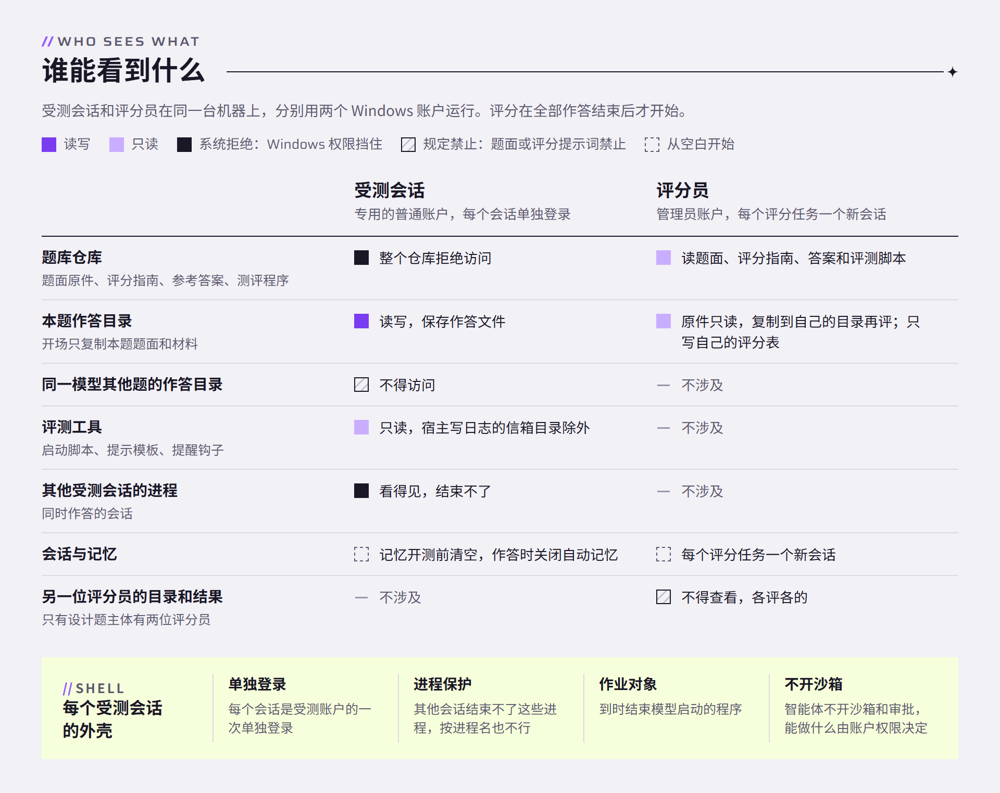</p>

| Item | Practice |
|---|---|
| Graders | Claude Opus 5.5 and GPT 6.1 Sol; reasoning effort `xhigh` for the original math olympiad problems and formal proofs, `high` for everything else |
| Sessions | Under the administrator account, each grading job opens a new session; graders know which model is being tested |
| Order | The 16 main sessions grade at the same time; after they have all finished, the 3 performance sessions (ray tracing, circuit, Siege & Conquest) run one at a time in task-table order, with the machine to themselves |
| Version graded | Always the contents of the work folder when answering ended, not git commits |
| Web works | Using the local headless Chrome, operated and screenshotted through the DevTools protocol, with `index.html` opened via `file:///` |
| If it will not open | A work that cannot run fully as local files is served from a local web server and graded as usual |
| Desktop works | Nested OS is launched following its launch instructions and `automation.json`, with its data directory placed in the grader's own work folder, and operated and screenshotted through the DevTools protocol; only the work's own windows are opened, and the desktop is never controlled or captured |
| Luban lock | First read the tested session's record to confirm that only the two tools provided with the task were run, then verify the disassembly tree and count steps with the grading-side checker |
| Structure reconstruction | First read the tested session's record to confirm that only the preview tool provided with the task was run, then use the grading-side program to build solids from the descriptions and compare their surface match against the original design parts |
| Submission format | If file names, locations or formats are slightly off, the matching content is found and graded as usual |
| Keep it simple | Score from actual performance against the guide's points; the main stage does not measure performance; in the performance stage, ray tracing runs the baseline and the submission 5 times each and takes the minimum, the circuit runs each input 3 times and takes the median, and Siege & Conquest plays one pass of 480 games (8 at a time) |
| Delivery | Fill in the grading sheet in the work folder and write the result file; the total is summed from the items by a program |

## Scoring

Each task is first converted to a 0–100 score, and the scores are then weighted into the model's total. Each task's scoring directions and points are in the task cards above; this chapter covers only the mechanism.

<p align="center">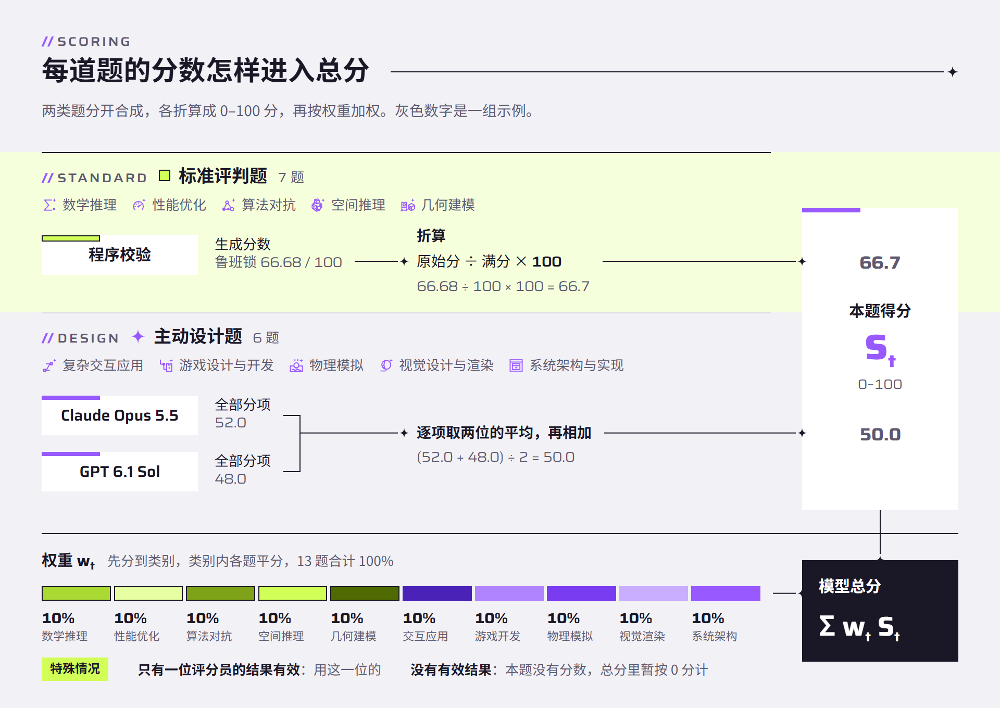</p>

### How the Total Is Composed

| | Standard-judged tasks (7) | Open design tasks (6) |
|---|---|---|
| **Who grades** | Scores generated by programmatic checks | Each item: graded once each by Claude Opus 5.5 and GPT 6.1 Sol |
| **How points are given** | Formal proofs, the performance tasks, Siege & Conquest, Luban lock and structure reconstruction are scored by their scoring definitions; the math olympiad problems get 0–7 points each following IMO grading practice | Each item is scored directly within its points, based on how well that point is achieved; no tiers, no deductions, no zeroing |
| **How items combine** | The scores from the programmatic checks are used directly | Average the two graders item by item, then sum |
| **Conversion** | Raw score ÷ full marks × 100 | Combined score ÷ full marks of 100 × 100 |

$$
\text{Model total}=\sum_{t=1}^{13} w_t\,S_t,\qquad \sum_{t=1}^{13} w_t=100\%
$$

- $S_t$ is task $t$'s converted 0–100 score, and $w_t$ is its weight.
- A category's score is the weighted average of its tasks.

<details>
<summary>Grading failures and precision</summary>

- If only one main grader's result is valid for a design task, the main items use that grader's scores.
- A failed grading stage is retried at most once. A task still missing a required stage after the retry gets no task score, and the remaining items are not scaled up; it counts as 0 in the model's total for now and is marked provisional.
- Items, task scores and totals keep one decimal place; weights use exact values and are not rounded.

</details>

### Scoring by Task Type

<p align="center"></p>

<details>
<summary>Performance engineering tasks: speedup and anchors</summary>

- The baseline and the submission run under the same conditions: the same set of logical processors (16–27 for ray tracing, 0–15 for the circuit), high priority and the same environment variables; only the wall-clock time of the one call to the core function is counted.
- For the circuit task, $R_i$ and $C_i$ are the median times of the baseline and the submission over 3 runs on input $i$, $s_i=R_i/C_i$, and $k$ is the number of correctness inputs passed; ray tracing has only one performance input, $R$ and $C$ are the minimum times of the baseline and the submission over 5 runs, $s=R/C$, $c$ is the average image verdict over the 5 timed runs, and $h$ is the average verdict over the 12 hidden correctness inputs (pass 1, slightly over tolerance 0.5, fail or error 0). Both tasks interpolate between anchors $(a_m,p_m)$ on a logarithmic scale, written $f$.

$$
f(v)=p_m+(p_{m+1}-p_m)\,\frac{\ln(v/a_m)}{\ln(a_{m+1}/a_m)},\qquad
\text{Ray tracing}=f(s)\cdot c\cdot h,\qquad
\text{Circuit}=\frac{k}{7}\cdot\frac{1}{9}\sum_{i=1}^{9}f(s_i)
$$

| Ray tracing $s$ | 1 | 2 | 4 | 6 | 8 | 10 |
|---|---|---|---|---|---|---|
| Speed score $q$ | 0 | 22 | 50 | 70 | 87 | 100 |

| Circuit inputs 1–6 $s_i$ | 0.1 | 0.5 | 1 | 2 | 4 | 6 | 8 | 10 | 12 |
|---|---|---|---|---|---|---|---|---|---|
| Score | 0 | 5 | 12 | 27 | 47 | 62 | 76 | 89 | 100 |

| Circuit inputs 7–9 $s_i$ | 0.1 | 0.5 | 1 | 2 | 4 | 6 | 8 |
|---|---|---|---|---|---|---|---|
| Score | 0 | 5 | 15 | 35 | 65 | 85 | 100 |

</details>

<details>
<summary>Siege & Conquest: scoring by results</summary>

Each game: win 1, draw 0.5, loss 0, 480 games in all (5 tiers × 96 maps, one game per map, seats alternating between adjacent maps). $R_1<\dots<R_5$ are the ratings (Elo scale) of the five baseline tiers, frozen after they play each other, $R_{(j)}$ is the rating of game $j$'s opponent, and $s_j$ is the score of that game. The model's rating $r$ satisfies the equation below, clamped to $[R_1-200,\ R_5+200]$:

$$
\sum_{j=1}^{480}\frac{1}{1+10^{(R_{(j)}-r)/400}}=\sum_{j=1}^{480}s_j,\qquad
\text{Siege}\ \&\ \text{Conquest}=20(k-1)+20\cdot\frac{r-R_k}{R_{k+1}-R_k}\quad(R_k\le r\le R_{k+1})
$$

When $R_5\le r\le R_5+200$ the score is $80+20(r-R_5)/200$. $r\le R_1$ scores 0 and $r\ge R_5+200$ scores 100; matching the strongest tier gives 80. There is no bonus for troop margins.

</details>

<details>
<summary>Luban Lock Disassembly: scoring by steps</summary>

$N_i$ is the total step count of puzzle $i$'s legal complete route, $B_i$ is the puzzle's fixed baseline step count (the reference solution's full step count), and $w_i$ is its points. A full disassembly is guaranteed 60% however roundabout it is:

$$
\text{Score}_i=w_i\cdot\max\!\left(0.6,\ \min\!\left(1,\ \frac{B_i}{N_i}\right)\right)
$$

For an unfinished puzzle, checking proceeds step by step from the starting state in the checker's depth-first order, up to the first collision, notation error or unseparated branch, and $k$ separations were legally completed before that point; $S_{i,k}$ is the sum of the steps the reference solution uses for its first $k$ separations (the steps of all the reference solution's separations add up to $B_i$). Every completed separation adds points, and partial credit is at most 50%:

$$
\text{Score}_i=w_i\cdot 0.5\cdot\frac{S_{i,k}}{B_i},\qquad
\text{Luban lock}=\sum_{i=1}^{8}\text{Score}_i
$$

| Tier | Easy | Medium | Hard |
|---|---|---|---|
| Puzzles | 01, 02 | 03–06 | 07, 08 |
| Points per puzzle $w_i$ | 8 | 12 | 18 |

A puzzle with no completed separation scores 0.

</details>

<details>
<summary>Mechanical Structure Reconstruction: two-level match scoring</summary>

At each level, $P$ is weighted by answer surface area, and $R$ weights equally the reference faces obtained after merging connected faces of the same surface. At 0.2 mm one translation for the whole problem is solved first and reused at 2 mm, with no rotation; F is computed for each level separately and then combined, with the loose level counting for only 20%.

$$
\begin{aligned}
F_{i,\tau}&=\frac{2P_{i,\tau}R_{i,\tau}}{P_{i,\tau}+R_{i,\tau}},\quad \tau\in\{0.2,2\}\text{ mm}\\
F_i^*&=0.8F_{i,0.2}+0.2F_{i,2}\\
\text{Score}_i&=w_i\min(1,F_i^*/0.99),\qquad \text{Reconstruction}=\sum_{i=1}^{25}\text{Score}_i
\end{aligned}
$$

| Tier | Easy | Medium | Hard |
|---|---|---|---|
| Problems | 01–08 | 09–15 | 16–25 |
| Points per problem | 3.5 | 4 | 4.4 |
| Tier total | 28 | 28 | 44 |

Assemblies are compared by item number in the parts list; at each level P and R are pooled before computing F, and the two levels' F are then combined, without averaging per-part F. Reference faces of missing parts count as 0.

</details>

### Scoring Design Tasks

<p align="center">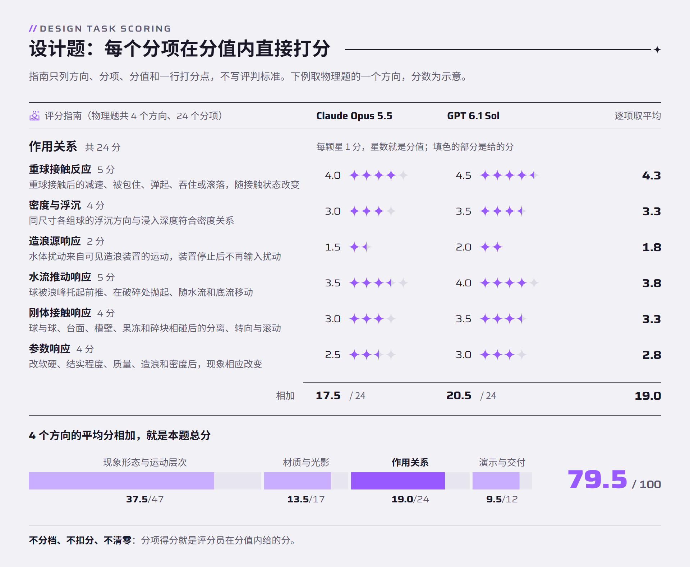</p>

Each task's guide has 4–8 directions and 19–30 items, giving only the points and a one-line scoring note for each, with points totaling 100; graders give a score within the points based on how well that point is achieved, where full marks mean excellent quality on that point; decimals are allowed, kept to one decimal place.

## Topic Folder

- Statements are kept under `题面/` in folders by category, one `.md` per task; the official schedule has 10 categories. When a test starts, only that one task's statement is copied into its work folder. Original Math Olympiad Problems also brings a folder of the 24 problems (named `题目` in the work folder); Luban Lock Disassembly also brings the eight locks' data and two tools (the folder keeps its original name `鲁班锁拆解`); Mechanical Structure Reconstruction also brings the 25 sets of drawings, 《建模描述》 (the model description spec) and the preview tool (the folder keeps its original name `机械结构重建`); ray tracing also brings the evaluation program, headers, baseline source and build script (in the root of the work folder) plus a `数据` folder (checking tool, compiled baseline, inputs and reference answers); the circuit task also brings a `数据` folder (evaluation program, checking tool, inputs and reference answers); and Siege & Conquest also brings a `数据` folder (resolution engine, main program, map generator, local match tool and sample program; still being made).
- `评分/` holds the grading materials: grading guides, blank grading sheets, reference answers, hidden test data and evaluation scripts.

```text
专题/十项全能/
├─ README.md  README.en.md   this README
├─ 专题.json         topic manifest: categories, task groups, weights, time limits, deliverables, answering resources and grading fields
├─ 参测.json         tested models with their agent and reasoning effort
├─ 题面/
│  ├─ 数学推理/           Statements in folders by category, one .md per task
│  │  ├─ 形式化证明题.md
│  │  ├─ 数学竞赛原创试题.md
│  │  └─ 数学竞赛原创试题/     24 problems, one file each
│  ├─ 性能优化/
│  │  └─ 性能工程/
│  │     ├─ 光线追踪渲染加速.md
│  │     ├─ 光线追踪渲染加速/        evaluation program grader.cu, headers, baseline reference.cu, build.py; 数据/ holds the checking tool, compiled baseline, inputs and reference answers
│  │     ├─ 数字电路仿真器加速.md
│  │     └─ 数字电路仿真器加速/      evaluation program grader.cpp, checking tool check.py, compiled baseline reference.exe (inputs and reference answers are in the grading folder)
│  ├─ 算法对抗/
│  │  └─ 攻城略地.md
│  ├─ 空间推理/
│  │  ├─ 鲁班锁拆解.md
│  │  └─ 鲁班锁拆解/        layered drawings and voxel data for the eight locks; 工具/ holds the route checker check.py and the position bookkeeping tool positions.py
│  ├─ 几何建模/
│  │  ├─ 机械结构重建.md
│  │  └─ 机械结构重建/      25 sets of drawings (PNG plus JSON dimension and view metadata), 建模描述.md; 工具/ holds only the preview tool preview.py and drawkit
│  ├─ 复杂交互应用/
│  │  └─ AE风味动效设计编辑器.md
│  ├─ 游戏设计与开发/
│  │  └─ 动态路由塔防.md
│  ├─ 物理模拟/
│  │  └─ 果冻冲击与造浪水槽.md
│  ├─ 视觉设计与渲染/
│  │  ├─ 太阳雨渔港3D渲染.md
│  │  └─ 星际战舰编队.md
│  └─ 系统架构与实现/
│     └─ 操作系统嵌套.md
├─ 评分/            grading materials
│  ├─ README.md        grading roles, scoring and totals
│  └─ <category>/<task>/   one folder per task, matching the statements one to one
├─ 设计/            the star-atlas design system shared by the topic website, films, covers and this README's figures
│  ├─ stellar-ui-skill/   design rules and web kit: colours, type, components, motion
│  ├─ decor/              SVG decorations such as star charts and orbits
│  └─ icons/categories/   the 10 category icons (currentColor)
└─ assets/readme/   this README's figures and violet category icons; src/ holds the figure sources, and render.py renders the figures and colours the icons
```

What each task's folder under `评分/` contains (see [`评分/README.md`](评分/README.md) for details):

| Task | Files |
|---|---|
| Every task | `AI评分指南.md`: grading points; `评分表_6.1Sol.md`: blank grading sheet for 6.1Sol |
| The six open design tasks | Also `评分表_Opus5.5.md` |
| Formal Proofs | `参考答案.md`, plus eight complete Lean proofs under `参考证明/` |
| Original Math Olympiad Problems | `参考答案.md`: model solutions and each problem's 7-point scoring points |
| Siege & Conquest | The five baseline tiers, 96 hidden map seeds, `baselines.json` with the official ratings, and `evaluate.py`; one game per map with alternating seats, converted with anchors at 0/20/40/60/80 and 100 at the strongest tier +200 |
| The two performance engineering tasks | Baselines, input generators, evaluation programs, performance inputs and reference answers; the circuit task also has 7 correctness inputs, scored by `evaluate.py` in the parent directory; ray tracing also has 12 hidden correctness inputs, scored by `evaluate.py` in its own directory |
| Luban Lock Disassembly | `参考答案.md`: basis for the tiers and the reference routes' step counts; `标准解答/`: reference routes for the eight puzzles; `check.py`, `grade.py`: check disassembly trees, count steps and score; `references.json`: each puzzle's source, tier, points, reference step count, baseline step count B (taken as the reference step count) and the reference solution's step count per stage; `test_grading.py`: tests for the grading scripts |
| Mechanical Structure Reconstruction | `参考答案.md`: notes on each problem's parts; `参考答案/`: model descriptions of the reference parts for all twenty-five problems; `grade.py`: builds solids from the descriptions, compares surface match and scores; `references.json`: each problem's tier, points and scoring parameters; the drawing generator, drawing spec and replay data export are described in that directory's `README.md` |

## Task-Setting and Grading Principles

The general principles for setting and answering tasks are in the [platform README](../../README.en.md#general-principles); the ones below are specific to this topic.

### Setting the Tasks

- **Workload deliberately exceeds the time limit**: design tasks contain more than can be finished in the time. What counts is what gets done first, how complete it is and how good it is.
- **AE's difficulty lies in the coupling**: the parts pull on one another, so doing one part well on its own is not enough; everything has to hold at the same time when put together.
- **Math olympiad problems chosen by real runs**: the math olympiad problems are newly set originals: the 12 most time-consuming were picked from the candidates by measured per-problem time, then 1 more combinatorics problem was added from the same candidate pool; from all unused candidates (including the two rounds of new problems in `调研/数学竞赛新题`), the two that took GPT 6.1 Sol longest to solve blind without tools were picked; four new problems adapted from research-level math samples were added and one was withdrawn; then six more originals that had passed blind tool-free testing and independent checking were added, 24 in all, ordered by difficulty with reference to the official test scores and the blind solving times.

### Answering

- **The two kinds are treated differently**: open design tasks are asked to push completeness high against the statement, and the odd small bug has little effect on the score; standard-judged tasks are only asked to solve according to the statement.

### Grading

- **Grading follows the statement**: grading guides list directions and items according to the statement's scoring criteria. The scoring directions of a design task are independent of one another, and the same thing is counted only once, in one item.
- **What can be computed goes to tools**: Lean compilation, performance speedups, Siege & Conquest game results, the legality and step count of Luban lock routes, and the shape match in structure reconstruction are all computed exactly by tools. Graders judge only the parts that need judgment.
- **Discrimination sits in the strong-model range**: the performance tasks interpolate piecewise on anchor tables, with the slope increasing segment by segment from the low range to the upper-middle range. Conventional methods only reach the low range, and works at an upper-middle level pull clearly ahead.
